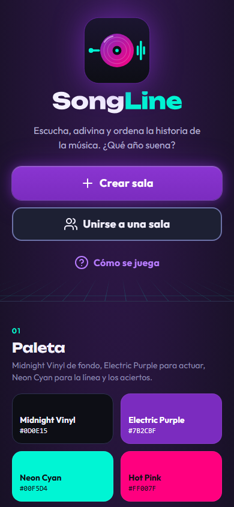
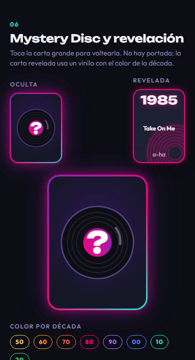
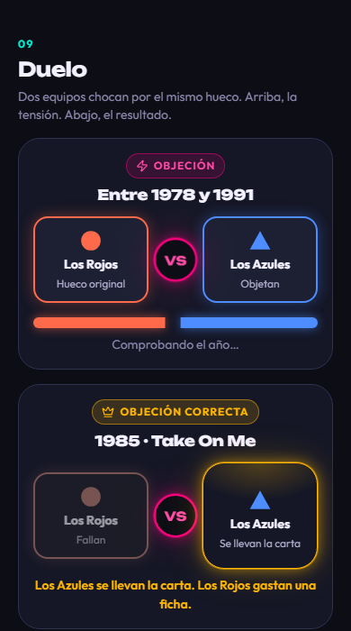
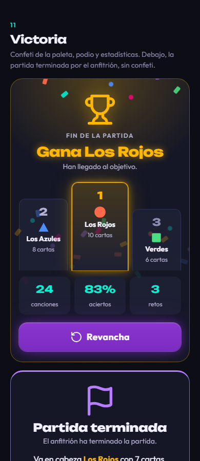

# SongLine · Dirección de arte y sistema visual

Documento de diseño para rehacer la interfaz. Los tokens listos para pegar están en `design-system/songline/MASTER.md`. La maqueta navegable está en `docs/design-preview.html` (ábrela con ancho 390 px).






Eslogan: «Escucha, adivina y ordena la historia de la música. ¿Qué año suena?»

Restricciones de producto que el diseño respeta: no hay portada de canción antes ni después de la revelación (regla antitrampas), el anfitrión es el único que reproduce audio, los textos viven en `es.ts` y los iconos son Lucide.

---

## A. Concepto gráfico y vibe general

**Narrativa: Neon Pop de noche.** Una sala a oscuras con un tocadiscos encendido. El fondo es casi negro con un matiz violeta. Lo que importa brilla: la línea del tiempo, la carta que suena, el equipo que juega y las fichas de reto. Nada más brilla. Esa contención hace que el brillo funcione como señal y no como decoración.

**Metáfora principal: el vinilo recorre la línea.** Una canción es un disco. La línea del tiempo es el brazo del tocadiscos extendido en horizontal. Las tres ideas se conectan así:

| Idea | Forma | Dónde aparece |
|---|---|---|
| Onda de sonido | Barras verticales de distinta altura, en cian | Logo, indicador «sonando», cuenta atrás, brillo de la carta |
| Vinilo | Disco con surcos concéntricos y etiqueta de color | Carta misteriosa, carta revelada (el color es la década), logo |
| Línea del tiempo | Raíl horizontal cian con brillo y nodos | Pantalla de juego, logo, rejilla del inicio |

**Registro visual.** Synth-Pop con acabado moderno: degradados violeta a magenta solo en el vinilo y los botones primarios, bordes de 2 px, radios generosos (16 y 24 px), brillos de color en lugar de sombras negras. Del retro quedan la rejilla en perspectiva del inicio y la tipografía ancha. Se descartan scanlines, pixel art y texturas de ruido: bajan el contraste y pesan en móviles modestos.

**Tono de movimiento.** Rápido y con rebote donde hay recompensa (anclar, ficha, victoria). Lento y suave donde hay tensión (pulso de la carta, duelo). Todo se apaga con `prefers-reduced-motion`.

---

## B. Paleta de colores

Los cinco colores del cliente se mantienen tal cual. Se añade un morado claro, un magenta de relleno y niveles de superficie, porque tres de los cinco fallan en alguna combinación (ver ajustes más abajo).

### Marca

| Nombre | HEX | Token | Función |
|---|---|---|---|
| Midnight Vinyl | `#0D0E15` | `--color-bg` | Fondo de toda la app |
| Electric Purple | `#7B2CBF` | `--color-primary` | Relleno de acción primaria e identidad |
| Neon Cyan | `#00F5D4` | `--color-accent` | Línea del tiempo, aciertos, selección |
| Hot Pink | `#FF007F` | `--color-magenta` | Retos: borde, brillo, icono |
| Retro Amber | `#FFB703` | `--color-gold` | Fichas, ganador, recompensa |

### Añadidos y justificación

| Nombre | HEX | Token | Por qué existe |
|---|---|---|---|
| Ultraviolet | `#B77CFF` | `--color-primary-light` | Electric Purple como texto o borde sobre `#0D0E15` da 2,7:1. Esta variante da 6,7:1 |
| Hot Pink Light | `#FF4DA6` | `--color-magenta-light` | Texto de reto. Da 6,3:1 sobre el fondo |
| Deep Magenta | `#D6006B` | `--color-danger` | Blanco sobre `#FF007F` da 3,8:1 y falla. Sobre `#D6006B` da 5,2:1 |
| Vinyl Surface | `#151726` | `--color-surface` | Paneles y tarjetas |
| Raised Groove | `#1D2033` | `--color-surface-2` | Modales, cartas, botón secundario |
| Deep Groove | `#272B45` | `--color-surface-3` | Pistas de barras y hover |

### Texto, bordes y estados

| Token | HEX | Uso |
|---|---|---|
| `--color-fg` | `#F4F1FF` | Texto principal |
| `--color-fg-2` | `#B4B0D0` | Texto secundario |
| `--color-fg-3` | `#8E8BB0` | Ayuda y metadatos |
| `--color-fg-disabled` | `#6E7096` | Deshabilitado |
| `--color-border` | `#2E3250` | Separador decorativo |
| `--color-border-strong` | `#6C72A8` | Borde de controles y huecos |
| `--color-primary-hover` / `-pressed` | `#8A35D1` / `#6A1FA8` | Estados del primario |
| `--color-accent-pressed` | `#00C9AE` | Estado pulsado del botón cian |
| `--color-danger-pressed` | `#B80059` | Estado pulsado del peligro |
| `--color-focus` | `#00F5D4` | Anillo de foco, 3 px, separación 3 px |

### Equipos: color y forma

| Slot | Nombre (`es.identity.colors`) | HEX | Forma |
|---|---|---|---|
| 1 | Rojo | `#FF6B4A` | Círculo |
| 2 | Azul | `#4D8DFF` | Triángulo |
| 3 | Verde | `#4ADE80` | Cuadrado |
| 4 | Morado | `#C084FC` | Rombo |

El rojo es un coral anaranjado para que no se confunda con el magenta de los retos. Cada equipo se identifica por color, forma y nombre. Nunca solo por color.

### Color por década (vinilo de la carta revelada)

`--decade-50` `#FFD166` · `--decade-60` `#FF9F1C` · `--decade-70` `#FF6B4A` · `--decade-80` `#FF007F` · `--decade-90` `#B77CFF` · `--decade-00` `#4D8DFF` · `--decade-10` `#00F5D4` · `--decade-20` `#4ADE80`. Antes de 1950 usa `#FFD166`. Es decoración. El año va siempre en texto.

### Contraste calculado (WCAG 2.1)

| Pareja (texto sobre fondo) | Ratio | Resultado |
|---|---|---|
| `#F4F1FF` sobre `#0D0E15` | 17,3 | AAA |
| `#F4F1FF` sobre `#1D2033` | 14,4 | AAA |
| `#B4B0D0` sobre `#151726` | 8,5 | AAA |
| `#8E8BB0` sobre `#151726` | 5,5 | AA |
| `#8E8BB0` sobre `#1D2033` | 4,95 | AA |
| `#00F5D4` sobre `#0D0E15` | 13,8 | AAA |
| `#0D0E15` sobre `#00F5D4` (botón acento) | 13,8 | AAA |
| `#FFB703` sobre `#0D0E15` | 11,0 | AAA |
| `#0D0E15` sobre `#FFB703` | 11,0 | AAA |
| `#FFFFFF` sobre `#7B2CBF` (botón primario) | 7,1 | AAA |
| `#FFFFFF` sobre `#8A35D1` (parte alta del degradado) | 6,0 | AA |
| `#B77CFF` sobre `#0D0E15` | 6,7 | AA |
| `#B77CFF` sobre `#272B45` | 4,8 | AA |
| `#FF4DA6` sobre `#151726` | 5,8 | AA |
| `#FFFFFF` sobre `#D6006B` (botón peligro) | 5,2 | AA |
| `#FF007F` sobre `#0D0E15` (borde, icono) | 5,1 | Cumple 3:1 |
| `#7B2CBF` sobre `#0D0E15` | 2,7 | Falla. No usar como texto ni borde |
| `#FFFFFF` sobre `#FF007F` | 3,8 | Falla. No usar |
| `#6C72A8` sobre `#0D0E15` / `#151726` / `#1D2033` (borde de control) | 4,2 / 3,9 / 3,5 | Cumple 3:1 |
| `#2E3250` sobre `#0D0E15` | 1,55 | Solo decorativo |
| `#6E7096` sobre `#0D0E15` (deshabilitado) | 4,05 | Exento |
| Equipos `#FF6B4A` `#4D8DFF` `#4ADE80` `#C084FC` sobre `#151726` | 6,3 / 5,6 / 10,2 / 6,7 | AA |

Los ratios se calcularon con la fórmula de luminancia relativa de WCAG 2.1. La tabla completa está en `MASTER.md`.

### Tokens de brillo (glow)

| Token | Valor |
|---|---|
| `--glow-primary` | `0 0 0 1px rgba(183,124,255,.45), 0 0 18px rgba(123,44,191,.60), 0 0 48px rgba(123,44,191,.30)` |
| `--glow-accent` | `0 0 0 1px rgba(0,245,212,.50), 0 0 14px rgba(0,245,212,.55), 0 0 40px rgba(0,245,212,.22)` |
| `--glow-magenta` | `0 0 0 1px rgba(255,0,127,.50), 0 0 16px rgba(255,0,127,.55), 0 0 44px rgba(255,0,127,.25)` |
| `--glow-gold` | `0 0 0 1px rgba(255,183,3,.55), 0 0 16px rgba(255,183,3,.55), 0 0 44px rgba(255,183,3,.22)` |
| `--glow-text-accent` | `0 0 12px rgba(0,245,212,.65)` |
| `--glow-text-magenta` | `0 0 12px rgba(255,0,127,.70)` |
| `--glow-text-gold` | `0 0 14px rgba(255,183,3,.60)` |

El brillo de texto solo se aplica a titulares y cifras grandes (24 px o más). En cuerpo de texto emborrona.

---

## C. Tipografía y jerarquía

| Rol | Fuente | Motivo |
|---|---|---|
| Display: logo, años, titulares, contadores | **Unbounded** | Geométrica y ancha. Las cifras se leen desde lejos y tiene energía de videojuego sin caer en el pixel art. Pesos 600 a 800 |
| Interfaz: textos, botones, etiquetas | **Outfit** | Geométrica limpia, redondeada y legible a 12 px. Pesos 400 a 700 |

Ambas están en Google Fonts y cubren á é í ó ú ü ñ ¿ ¡ (comprobado en los glifos de Unbounded; Outfit incluye latin-ext completo). La skill propuso Righteous/Poppins y Russo One/Chakra Petch. Se descartan: Righteous tiene cifras estrechas y Russo One es muy pesada en pantallas pequeñas.

**Importación:**

```html
<link rel="preconnect" href="https://fonts.googleapis.com">
<link rel="preconnect" href="https://fonts.gstatic.com" crossorigin>
<link href="https://fonts.googleapis.com/css2?family=Outfit:wght@400;500;600;700&family=Unbounded:wght@600;700;800&display=swap" rel="stylesheet">
```

**Fallbacks:** `--font-display: 'Unbounded', 'Arial Black', 'Segoe UI', system-ui, sans-serif` y `--font-ui: 'Outfit', system-ui, -apple-system, 'Segoe UI', Roboto, sans-serif`. El fallback de Unbounded es mucho más estrecho: reservad ancho mínimo en contadores y no uséis `white-space: nowrap` en el año de la carta pequeña sin comprobar el desborde.

**Escala:**

| Elemento | Fuente | Peso | Tamaño | Interlínea | Tracking |
|---|---|---|---|---|---|
| Año hero (carta grande revelada) | Unbounded | 800 | 56 px | 1 | -0,02em |
| Año de carta (línea del tiempo) | Unbounded | 800 | 24 px | 1 | -0,01em |
| Titular de pantalla | Unbounded | 800 | 32 px | 1,1 | -0,02em |
| Subtítulo | Unbounded | 700 | 22 px | 1,2 | -0,01em |
| Nombre de canción (carta grande) | Outfit | 700 | 24 px | 1,2 | 0 |
| Etiqueta de hueco («Entre 1978 y 1991») | Outfit | 600 | 20 px | 1,2 | 0 |
| Artista (carta grande) | Outfit | 500 | 16 px | 1,3 | 0 |
| Título y artista en carta pequeña | Outfit | 600 y 500 | 12 px | 1,2 | 0 |
| Contador `x/objetivo` | Unbounded | 700 | 18 px | 1 | 0 |
| Nombre de equipo | Outfit | 700 | 14 px | 1,2 | 0 |
| Botón | Outfit | 700 | 16 px (grande 18) | 1 | +0,02em |
| Cuerpo | Outfit | 400 | 16 px | 1,5 | 0 |
| Etiqueta (overline) | Outfit | 600 | 12 px | 1,2 | +0,12em, mayúsculas |
| Texto de ayuda | Outfit | 400 | 14 px | 1,45 | 0 |

Mínimo 12 px en todo el producto. Cuerpo 16 px. En la carta pequeña el título se corta a 2 líneas y el artista a 1 (`text-overflow: ellipsis`); la carta grande muestra el título completo hasta 3 líneas.

---

## D. Logotipo

### Las tres propuestas

**1. Onda temporal.** Una línea horizontal cian que arranca plana a la izquierda y se convierte en una onda de audio a la derecha. En el centro, un punto. Idea clara («el tiempo se vuelve sonido») pero genérica: se parece a cualquier app de podcasts y no dice «vinilo» ni «juego». A 16 px es una raya.

**2. Del vinilo al timeline.** Un disco de vinilo con degradado violeta a magenta, atravesado por la línea del tiempo. A la izquierda la línea es plana y acaba en un nodo (el pasado ordenado). A la derecha salen tres barras de onda (la canción que suena). Cuenta la mecánica entera: un disco que se coloca en una línea. Funciona a 32 px porque el disco es una masa de color reconocible.

**3. Tipográfica con símbolos.** «SongLine» en Unbounded 800, donde la `o` de «Song» es un vinilo y la `i` de «Line» lleva un punto cian. Distintiva y fácil de escalar, pero depende de la fuente y en tamaño de icono de app solo queda una letra «S».

### Elección: la 2

Gana porque une las dos ideas del producto (vinilo y línea) en una silueta que se reconoce a 32 px, y porque da un icono de app sin texto. Los colores salen de la paleta: disco en degradado `#7B2CBF` a `#FF007F`, línea y onda en `#00F5D4`, fondo `#0D0E15`. El nombre se compone aparte, en Unbounded 800: «Song» en `#F4F1FF` y «Line» en `#00F5D4`. La propuesta 3 se aprovecha en el nombre: el color partido en dos palabras.

### Archivos

| Archivo | Contenido |
|---|---|
| `apps/web/public/logo/songline-mark.svg` | Isotipo cuadrado 512×512, sin texto, tesela redondeada oscura incluida |
| `apps/web/public/logo/songline-wordmark.svg` | Solo texto. Glifos convertidos a trazos (Unbounded 800, licencia OFL), sin dependencia de fuente |
| `apps/web/public/logo/songline-logo.svg` | Isotipo + texto en horizontal, `viewBox="0 0 742.1 128"` |
| `apps/web/public/favicon.svg` | Copia del isotipo |
| `apps/web/public/icons/icon-192.png`, `icon-512.png` | Isotipo con tesela redondeada sobre transparente |
| `apps/web/public/icons/icon-maskable-512.png` | Fondo sólido `#0D0E15` a sangre, motivo escalado al 80 % centrado, sin tesela |

Todos funcionan sobre fondo oscuro. Para fondo claro (no hay en la app) harían falta dos tintas distintas; no se entrega.

**Isotipo (código final):**

```svg
<svg xmlns="http://www.w3.org/2000/svg" viewBox="0 0 512 512" role="img" aria-labelledby="t"><title id="t">SongLine</title>
<defs>
<linearGradient id="sl-disc" x1="0" y1="0" x2="1" y2="1"><stop offset="0" stop-color="#7B2CBF"/><stop offset="1" stop-color="#FF007F"/></linearGradient>
<linearGradient id="sl-bg" x1="0" y1="0" x2="0" y2="1"><stop offset="0" stop-color="#1B1530"/><stop offset="1" stop-color="#0D0E15"/></linearGradient>
</defs>
<rect x="6" y="6" width="500" height="500" rx="112" fill="url(#sl-bg)" stroke="#7B2CBF" stroke-opacity=".7" stroke-width="4"/>
<g fill="none" stroke="#00F5D4" stroke-linecap="round" stroke-linejoin="round" stroke-width="16"><path d="M58 256H118"/><path d="M414 226V286M438 190V322M462 232V280"/></g>
<circle cx="58" cy="256" r="18" fill="#00F5D4"/>
<circle cx="256" cy="256" r="128" fill="url(#sl-disc)"/>
<g fill="none" stroke="#fff" stroke-opacity=".22" stroke-width="5"><circle cx="256" cy="256" r="100"/><circle cx="256" cy="256" r="72"/></g>
<path d="M160 192A108 108 0 0 1 224 148" fill="none" stroke="#fff" stroke-opacity=".5" stroke-width="10" stroke-linecap="round"/>
<circle cx="256" cy="256" r="34" fill="#0D0E15"/><circle cx="256" cy="256" r="13" fill="#00F5D4"/>
</svg>
```

El `wordmark` y el logo horizontal usan trazos de glifos (unos 3 KB de `path`). Se incluyen tal cual en los ficheros y no se reproducen aquí.

Uso: margen de respeto igual a la altura de la «L» alrededor. Tamaño mínimo del isotipo 24 px, del logo horizontal 120 px de ancho. Sin sombras añadidas salvo el halo violeta del inicio (`drop-shadow(0 0 24px rgba(123,44,191,.7))`).

**Cambios que debe hacer el implementador:** en `vite.config.ts`, `theme_color: '#0D0E15'` y `background_color: '#0D0E15'`; en `index.html`, `<meta name="theme-color" content="#0D0E15">`.

---

## E. Sistema de UI/UX para móvil

Convenciones: duraciones y curvas son los tokens de `MASTER.md` §4. `ease-out` = `cubic-bezier(.22,1,.36,1)`, `ease-in-out` = `cubic-bezier(.65,0,.35,1)`, `spring` = `cubic-bezier(.34,1.56,.64,1)`. Animar solo `transform`, `opacity`, `box-shadow` y `filter`.

**Regla de `prefers-reduced-motion: reduce` para todo el documento:** los tokens `--motion-*` pasan a 0 ms, se paran los bucles (pulso, giro del vinilo, confeti, tensión del duelo), el volteo es un cambio de cara inmediato, y los estados se siguen distinguiendo por borde, icono y texto. Embla usa `duration` bajo y sin inercia añadida.

### E.1 La línea del tiempo

Se mantiene la mecánica actual: la carta misteriosa está fija en el centro, la línea se desliza y cada parada (snap) es un hueco.

| Elemento | Especificación |
|---|---|
| Raíl | Barra de 4 px a media altura, `linear-gradient(90deg, transparent, #00F5D4 14%, #00F5D4 86%, transparent)`, `box-shadow: 0 0 14px rgba(0,245,212,.7), 0 0 36px rgba(0,245,212,.3)`, radio 2 px |
| Altura del bloque | 232 px (la carta misteriosa 140 px más holgura para el brillo) |
| Columna de hueco | 112 px de ancho (`GAP_W`). Hueco vacío de 100×140 px, radio 16, borde discontinuo 2 px `#6C72A8`, fondo `rgba(13,14,21,.85)`, icono Lucide `plus` 20 px en `#8E8BB0` |
| Columna de carta | 112 px de ancho (antes 100). Carta de año 104×148 px |
| Hueco seleccionado | Borde sólido 2 px `#00F5D4`, `--glow-accent`, `scale(1.1)`, icono cian. Transición 240 ms `ease-out` en `transform`, 160 ms en color y brillo |
| Hueco bloqueado | Borde sólido 2 px `#FF007F`, `--glow-magenta`, candado Lucide 22 px `#FF4DA6`. No se puede seleccionar para objetar; el snap pasa por encima sin marcar |
| Carta misteriosa | Fija, centrada con `position:absolute`, `pointer-events:none`. Queda 4 px por dentro del hueco seleccionado para que se vea el marco cian |
| Snap | Embla `duration: 22` (se mantiene), `slidesToScroll: 2`. Con reduce, `duration: 8` |
| Flechas ◀ ▶ | Botones secundarios 48×48 a cada lado de la etiqueta del hueco. Deshabilitados en el primer y último hueco (icono `#6E7096`, borde discontinuo). Se conservan `aria-label` y teclado ← → |
| Etiqueta del hueco | `role="status"`, 20 px Outfit 600, y debajo `Hueco 2 de 4` en 14 px `#8E8BB0` |
| Deslizar | Mientras se arrastra, los huecos cercanos pasan de opacidad .6 a 1 según su distancia al centro. Es opcional y gratuito si se calcula con `embla.scrollProgress()` |

**Carta anclada (acierto o colocación):** la carta nueva entra en su sitio con `scale(.8)` a `scale(1.08)` a `scale(1)` en 520 ms con `spring`. A la vez, el raíl sube de brillo (`filter: brightness(1.5)`) 300 ms y vuelve. Si el hueco era correcto se añade un anillo que se expande: `scale(1)` a `scale(1.6)` y opacidad .6 a 0 en 600 ms, color cian. Si era incorrecto la carta tiembla `translateX` 0, -6, 6, -4, 4, 0 px en 360 ms y el borde parpadea en `#FF007F` una vez. Con reduce: sin movimiento, solo el borde cambia de color y aparece el texto «Hueco correcto» o «Hueco incorrecto».

### E.2 Tarjeta de canción: oculta y revelada

**Mystery Disc (oculta).**

| Propiedad | Valor |
|---|---|
| Tamaños | 104×140 px en la línea, 200×270 px a pantalla grande |
| Fondo | `radial-gradient(90% 70% at 50% 40%, #2A1650, #151726 75%)` |
| Borde | 2 px (3 px en grande) con degradado `135deg, #7B2CBF, #FF007F 55%, #00F5D4`, hecho con doble `background` (`padding-box` y `border-box`) |
| Vinilo | SVG de disco negro `#0D0E15` con tres anillos de surcos al 12 % de blanco y etiqueta con degradado violeta a magenta. 78 px en pequeña, 150 px en grande. Gira 360° en 6 s `linear`, infinito, solo mientras suena |
| Signo `?` | Unbounded 800, 30 % del ancho de la carta, blanco, `--glow-text-magenta` |
| Brillo | Alterna cada 2400 ms con `ease-in-out`: de `0 0 14px rgba(123,44,191,.45)` a `0 0 22px rgba(255,0,127,.55), 0 0 56px rgba(123,44,191,.4)` |
| Reproduciendo | Tres barras de onda cian (4 px de ancho, 8 a 24 px de alto, 600 ms alternas escalonadas) bajo el disco. No se envía ningún dato de la canción |

**Revelación (volteo).**

| Fase | Tiempo | Detalle |
|---|---|---|
| Volteo | 0 a 700 ms | `rotateY(0)` a `rotateY(180deg)`, `ease-in-out`, `perspective: 900px`, `backface-visibility: hidden`. Es el mismo valor que ya usa el código (700 ms) |
| Cambio de brillo | 350 ms | A mitad de giro el borde pasa del degradado al color de la década |
| Aterrizaje | 700 a 1000 ms | `scale(1)` a `scale(1.04)` a `scale(1)`, `spring` |
| Año | 700 ms | Sube desde `opacity 0, translateY(8px)` a su sitio en 240 ms |

**Carta revelada, sin portada.** El color de la década sustituye a la imagen:

| Propiedad | Carta de línea (104×148) | Carta grande (200×270) |
|---|---|---|
| Fondo | `#1D2033` | `#1D2033` |
| Borde | 2 px color de la década | 3 px |
| Brillo | `0 0 14px` color al 40 % | igual |
| Vinilo decorativo | Círculo de 120 px recortado en la esquina inferior derecha (`right:-42px; bottom:-42px`), hecho con `repeating-radial-gradient` del color al 38 % y 14 %, agujero central de 12 px | 230 px, `right:-80px; bottom:-80px` |
| Año | Unbounded 800 24 px, `text-shadow` del color de la década al 70 % | 56 px |
| Título | Outfit 600 12 px, 2 líneas | Outfit 700 24 px, 3 líneas |
| Artista | Outfit 500 12 px, 1 línea | Outfit 500 16 px |
| Etiqueta de década (solo grande) | Overline 12 px del color de la década (`AÑOS 90`) | |

El texto va siempre sobre `#1D2033`. El vinilo de fondo queda al 38 % de opacidad como máximo, así que el contraste del artista (`#B4B0D0`) se mantiene en 6,6:1 o más sobre el punto más claro del dibujo.

### E.3 Fichas de reto

**Forma:** púa de guitarra (triángulo redondeado apuntando abajo), 44×52 px, con una nota musical oscura dentro. Es un objeto de jukebox: nombre «ficha», forma de púa.

```svg
<svg viewBox="0 0 40 48" width="44" height="52" aria-hidden="true">
  <defs><linearGradient id="pick" x1="0" y1="0" x2="0" y2="1"><stop offset="0" stop-color="#FFD166"/><stop offset="1" stop-color="#FFB703"/></linearGradient></defs>
  <path d="M20 46S3 30 3 16C3 7 10 2 20 2s17 5 17 14c0 14-17 30-17 30Z" fill="url(#pick)" stroke="#C98700" stroke-width="2"/>
  <path d="M11 14c2-4 6-6 10-6" stroke="#fff" stroke-opacity=".6" stroke-width="2.5" fill="none" stroke-linecap="round"/>
  <path d="M17 31V19l8-2v10" stroke="#0D0E15" stroke-opacity=".75" stroke-width="2.4" fill="none" stroke-linecap="round" stroke-linejoin="round"/>
  <circle cx="15" cy="31" r="2.4" fill="#0D0E15" fill-opacity=".75"/><circle cx="23" cy="27" r="2.4" fill="#0D0E15" fill-opacity=".75"/>
</svg>
```

| Estado | Aspecto |
|---|---|
| Disponible | Relleno ámbar, `filter: drop-shadow(0 0 8px rgba(255,183,3,.6))` |
| Gastada | Solo contorno discontinuo 2,5 px `#6C72A8` (`stroke-dasharray: 4 4`), sin relleno, sin brillo |
| En TeamPanel | Versión de 16×19 px y el número al lado en Outfit 700 14 px `#FFB703` |
| Contador grande | Unbounded 700 18 px `#FFB703` con `--glow-text-gold` |

**Animación al gastarla (900 a 1400 ms):**

1. 0 a 160 ms: la ficha crece `scale(1.25) rotate(-8deg)` con `spring`.
2. 160 a 630 ms: vuela hacia el hueco que se disputa (`translate` hasta el centro del hueco), girando a `rotate(18deg)` y bajando a `scale(.9)`, `ease-out`.
3. 630 a 770 ms: se encoge a `scale(.5)`, `opacity 0`. Salen 4 chispas magenta de 6 px que se separan 30 a 38 px en 500 ms y se desvanecen.
4. En el TeamPanel, la púa gastada pasa a contorno discontinuo y el número baja con un `scale(1.25)` de 240 ms.

Con reduce: la ficha desaparece sin viaje, el contorno discontinuo aparece al instante y se mantiene el texto «gasta una ficha».

### E.4 Disputa y duelo

Se muestra en el hueco disputado, a pantalla completa de la tarjeta de estado.

**Tensión (mientras se resuelve):**

| Elemento | Especificación |
|---|---|
| Contenedor | `#151726`, borde 1 px `#2E3250`, radio 24, padding 16 |
| Cabecera | Insignia magenta «Objeción» (icono `zap`) y debajo el hueco en Unbounded 800 16 px con efecto glitch |
| Glitch | Dos copias del texto en magenta y cian con `mix-blend-mode: screen`. Cada 1600 ms (`steps(1)`) saltan 2 a 3 px y se recortan con `clip-path: inset(...)` durante unos 100 ms |
| Combatientes | Rejilla `1fr 52px 1fr`. Tarjeta de equipo con borde 2 px del color del equipo, forma 26 px, nombre 14 px 700 y rol («Hueco original» / «Objetan») en 12 px `#B4B0D0`, halo `0 0 16px` color al 35 % |
| VS | Círculo de 48 px, fondo `#0D0E15`, borde 2 px `#FF007F`, texto Unbounded 800 14 px `#FF4DA6`, `--glow-magenta`. Late `scale(1) a scale(1.12) rotate(-4deg)`, 900 ms alterno |
| Barras en tensión | Dos barras de 12 px de alto en el color de cada equipo, que se encuentran en el centro. Cada una oscila `scaleX(.55)` a `scaleX(1)` en 700 ms `ease-in-out`, alterno, desfasadas 350 ms |
| Texto | «Comprobando el año…» 14 px `#8E8BB0` |

**Resultado:**

| Caso | Visual |
|---|---|
| Gana quien objeta | Insignia dorada «Objeción correcta» (icono `crown`). La tarjeta ganadora toma borde `#FFB703` y `--glow-gold`. La perdedora baja a opacidad .6 y `saturate(.4)`. El VS deja de latir. Debajo, línea `#FFB703` 600: «Los Azules se llevan la carta» |
| Gana el equipo original | Misma estructura con el equipo original dorado y «La carta se queda en Los Rojos». Insignia magenta «Objeción fallida» |
| Nadie acierta | Ambas tarjetas bajan a opacidad .6. «La carta se descarta» en `#B4B0D0` |

**Quién gana la carta:** a los 600 ms la carta revelada viaja (`translate` + `scale(.6)`, 600 ms `ease-out`) hasta el TeamPanel ganador, desaparece y el contador sube con `scale(1.25)` 240 ms `spring`. El texto de resultado queda visible mientras dura la animación y 2 s más.

Con reduce: sin glitch, VS y barras fijos, la carta aparece directamente en el panel ganador y la diferencia sale del borde dorado y el texto.

### E.5 Pantalla de victoria

**Victoria al completar las 10 cartas (`results.reasonTarget`):**

| Fase | Tiempo | Detalle |
|---|---|---|
| Destello | 0 a 300 ms | Fondo con `radial-gradient(90% 50% at 50% 0%, rgba(255,183,3,.25), transparent 70%)` que sube de 0 a 1 |
| Trofeo | 0 a 600 ms | Icono Lucide `trophy` de 64 px `#FFB703`, `drop-shadow(0 0 14px rgba(255,183,3,.6))`. `scale(.4) rotate(-8deg)` a `scale(1) rotate(0)`, `spring` |
| Titular | 200 a 560 ms | «Gana Los Rojos» Unbounded 800 26 px `#FFB703` con `--glow-text-gold`. Sube 12 px y entra con opacidad |
| Confeti | 0 a 8 s | 30 piezas (rectángulos de 8×14 px y círculos de 9 px) en `#00F5D4 #FF007F #FFB703 #B77CFF #FF6B4A #4D8DFF #4ADE80`. Caen `translateY` 100 % de la altura de la tarjeta con `rotate(540deg)`, duración 2600 a 4000 ms por pieza, `linear`, 2 repeticiones y se paran. Solo `transform` y `opacity` |
| Podio | 360 a 960 ms | Tres columnas `1fr 1.15fr 1fr` (2º, 1º, 3º). Alturas 140, 172, 120 px. Crecen desde `scaleY(0)` con origen abajo, 600 ms `ease-out`, escalonadas 120 ms (2º, 3º, 1º al final) |
| Podio, primero | | Borde `#FFB703`, `--glow-gold`, degradado `rgba(255,183,3,.2)` a `#1D2033` |
| Estadísticas | 900 ms | Tres cifras en Unbounded 700 20 px cian (canciones jugadas, % de aciertos, retos). Cuentan de 0 al valor en 800 ms |
| Botones | 1200 ms | `Revancha` (primario grande) y `Salir` (secundario). Entran con opacidad en 240 ms |

Si hay empate, los dos primeros comparten el escalón central y el titular usa `results.winners`.

**Partida terminada por el anfitrión (`results.reasonHost`):** sin confeti, sin trofeo, sin brillo dorado. Tarjeta `#151726` con borde 1 px `#6C72A8` y filete superior de 3 px `#B77CFF`. Icono `flag` 64 px `#B77CFF`. Titular «Partida terminada» en Unbounded 800 22 px. Debajo, «El anfitrión ha terminado la partida.» y una línea con quién va en cabeza («Va en cabeza Los Rojos con 7 cartas»), con el equipo en `#FFB703`. Se muestra la clasificación completa sin podio. Entrada: opacidad y `translateY(8px)` en 240 ms. Es la misma pantalla con otra cabecera: no se debe celebrar una partida que se cortó.

### E.6 Resto de pantallas y componentes

**Inicio.** Fondo `#0D0E15` con halo `radial-gradient(120% 40% at 50% 0%, rgba(123,44,191,.35), transparent 70%)`. Isotipo de 112 px con `drop-shadow(0 0 24px rgba(123,44,191,.7))`, wordmark de 220 px de ancho, eslogan en Outfit 400 16 px `#B4B0D0` con ancho máximo 290 px. Debajo, tres botones: `Crear sala` (primario grande, icono `plus`), `Unirse a una sala` (secundario grande, icono `users`) y `Cómo se juega` (fantasma, icono `circle-help`). Al pie, una rejilla en perspectiva de líneas cian al 22 % (`perspective(160px) rotateX(58deg)`, 120 px de alto, máscara de degradado a transparente). Es el único sitio con rejilla. `Cómo se juega` abre un modal con tres pasos numerados y un ejemplo de carta.

**Selector de packs de géneros.** Rejilla de 2 columnas, hueco 12 px. Tarjeta: `#151726`, borde 2 px `#2E3250`, radio 16, alto mínimo 96, padding 12. Icono Lucide de 28 px en `#B77CFF`, nombre en Outfit 700 16 px y número de canciones en 12 px `#8E8BB0`. Casilla redonda de 24 px arriba a la derecha con borde `#6C72A8`. Seleccionado: borde `#00F5D4`, `--glow-accent`, fondo `linear-gradient(160deg, rgba(0,245,212,.14), #151726 60%)`, icono cian, casilla rellena cian con `check` oscuro de 16 px. La casilla se rellena con `scale(.6)` a `scale(1)`, 160 ms `spring`. Pulsar: `scale(.97)`, 90 ms. Iconos sugeridos: Pop `sparkles`, Rock `guitar`, Disco y funk `disc-3`, Hip hop `mic-vocal`, Electrónica `zap`, Latino `flame`, Años 80 `radio`, Clásicos `piano`. Se exige al menos un pack; si se quita el último, el botón `Continuar` queda deshabilitado y la ayuda dice «Elige al menos un pack».

**Lobby.** El código de sala en Unbounded 800 40 px, `letter-spacing: .12em`, `#00F5D4`, `--glow-text-accent`, sobre tarjeta `#151726`. Los huecos de equipo son filas de 56 px: forma y color del equipo, nombre, estado de conexión (`wifi` o `wifi-off` con texto) y «Anfitrión». Hueco libre: borde discontinuo y texto «Hueco libre». `Empezar partida`: primario grande; deshabilitado con el motivo de `lobby.guards` en 14 px `#FF4DA6`. El estado «audio listo» usa icono `check` cian.

**Cuenta atrás 3-2-1.** Pantalla `#0D0E15` con el número centrado en Unbounded 800 160 px, `#F4F1FF` y `--glow-text-accent`. Cada segundo: entra con `scale(1.6)` y opacidad 0 a `scale(1)` y 1 en 250 ms `ease-out`, se mantiene y sale con opacidad 0 en los últimos 200 ms. Detrás, dos anillos cian que se expanden desde el centro (`scale(.4)` a `scale(2.4)`, opacidad .5 a 0, 1000 ms, uno por segundo). Debajo, «Empieza Los Rojos» en 20 px. Con reduce: el número cambia sin escala y sin anillos.

**TeamPanel.** Tarjeta `#151726`, borde 2 px `#2E3250`, radio 16, padding 10. Fila superior: forma 18 px, nombre (14 px 700, truncado con puntos suspensivos), icono de conexión 16 px (`wifi` cian o `wifi-off` magenta). Fila media: contador `6/10` en Unbounded 700 18 px y a la derecha la mini púa 16×19 con el número de fichas en 14 px ámbar. Barra de 8 px, radio 4, pista `#272B45`, relleno `linear-gradient(90deg, #7B2CBF, #00F5D4)` con `0 0 10px rgba(0,245,212,.6)`, el ancho anima en 360 ms `ease-out`. Turno activo: borde y halo del color del equipo (`0 0 0 1px color, 0 0 20px color al 50%`), fondo con el color al 12 %, y etiqueta «Turno» arriba a la derecha (píldora del color del equipo, texto `#0D0E15` 12 px 700). Sin conexión: icono `wifi-off`, el texto «Sin conexión» para lectores de pantalla y el panel conserva su opacidad (no se atenúa, para no bajar el contraste). El cambio de turno anima halo e intensidad en 360 ms.

**Modales.** Velo `rgba(6,6,12,.78)` con `backdrop-filter: blur(6px)`. Panel `#1D2033`, borde 1 px `#6C72A8`, radio 24, `--shadow-lg`, padding 24, ancho máximo 358 px. Título en Unbounded 700 22 px. Entrada: `translateY(16px) scale(.96)` y opacidad 0 a su sitio en 240 ms `ease-out`; el velo entra en 160 ms. Salida: 160 ms. Botones apilados a ancho completo; el primario arriba. Modal destructivo (`Terminar partida`): icono `flag` magenta, botón `Terminar` de peligro y `Seguir jugando` secundario. Foco atrapado, `Escape` cierra, y el foco vuelve al disparador.

**Botones.**

| Variante | Fondo | Texto | Borde | Brillo |
|---|---|---|---|---|
| Primario | `linear-gradient(180deg, #8A35D1, #7B2CBF)` | `#FFFFFF` | ninguno | `--glow-primary` + `inset 0 1px 0 rgba(255,255,255,.25)` |
| Secundario | `#1D2033` | `#F4F1FF` | 2 px `#6C72A8` | ninguno. Hover: borde y texto `#00F5D4` |
| Acento | `#00F5D4` | `#0D0E15` | ninguno | `--glow-accent` |
| Peligro | `#D6006B` | `#FFFFFF` | ninguno | `--glow-magenta` |
| Fantasma | transparente | `#B77CFF` | ninguno | ninguno |
| Deshabilitado | `#1D2033` | `#6E7096` | 2 px discontinuo `#2E3250` | ninguno |

Radio 16, alto 48 (grande 56), padding horizontal 24, Outfit 700 16 px con +0,02em. Pulsado: `translateY(2px) scale(.98)` en 90 ms y `inset 0 3px 8px rgba(0,0,0,.45)`. Foco: contorno de 3 px `#00F5D4` con 3 px de separación.

**«No es tu turno».** La línea queda en modo solo lectura: se ve la carta misteriosa fija pero la selección no se mueve con el dedo y los botones ◀ ▶ no aparecen. Encima del raíl, una tarjeta de 56 px con la forma y color del equipo activo, el texto «Le toca a Los Azules» en 20 px 600 y debajo, 14 px `#8E8BB0`, «Está colocando la carta.». El TeamPanel activo lleva su halo. Tres puntos de 6 px del color del equipo suben y bajan 4 px, 900 ms escalonados, en lugar del texto «Pensando…» con puntos suspensivos. Lo que ve el espectador no cambia por seguridad: la carta sigue como misteriosa hasta `REVEAL`.

**Pausa y reconexión.** Velo `rgba(6,6,12,.78)` sobre el juego, tarjeta central `#1D2033` con icono Lucide `wifi-off` de 40 px en `#FF4DA6` (o `pause` en `#B77CFF` si pausa el anfitrión), título Unbounded 700 22 px («Reconectando…», «El anfitrión ha perdido la conexión»), cuerpo 16 px `#B4B0D0` y una cuenta de segundos en Unbounded 700 18 px ámbar cuando hay salto de turno programado. Una barra de 4 px baja de derecha a izquierda durante el plazo, `linear`. El icono tiene un pulso de opacidad .6 a 1 en 1200 ms. Con reduce, sin pulso ni barra animada, solo los segundos.

---

## Lista previa a la entrega

- [x] Sin emojis como iconos: todo Lucide o SVG propio.
- [x] Contraste AA en cada pareja de texto (tabla de §B). Los fallos conocidos están marcados y no se usan.
- [x] Objetivos táctiles de 48 px o más, 8 px entre ellos.
- [x] Foco visible, 3 px cian.
- [x] `prefers-reduced-motion` definido para cada animación.
- [x] Texto mínimo de 12 px, cuerpo de 16 px.
- [x] Color nunca como único indicador: equipos con forma, turno con etiqueta, conexión con icono y texto, bloqueo con candado.
- [x] Fuentes solo de Google Fonts.
- [ ] Probar la maqueta en un móvil real (no se ha podido: solo hay Chromium de escritorio con viewport de 390 px).
