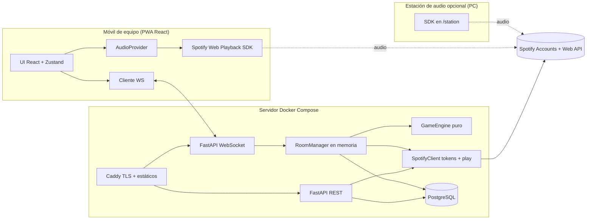
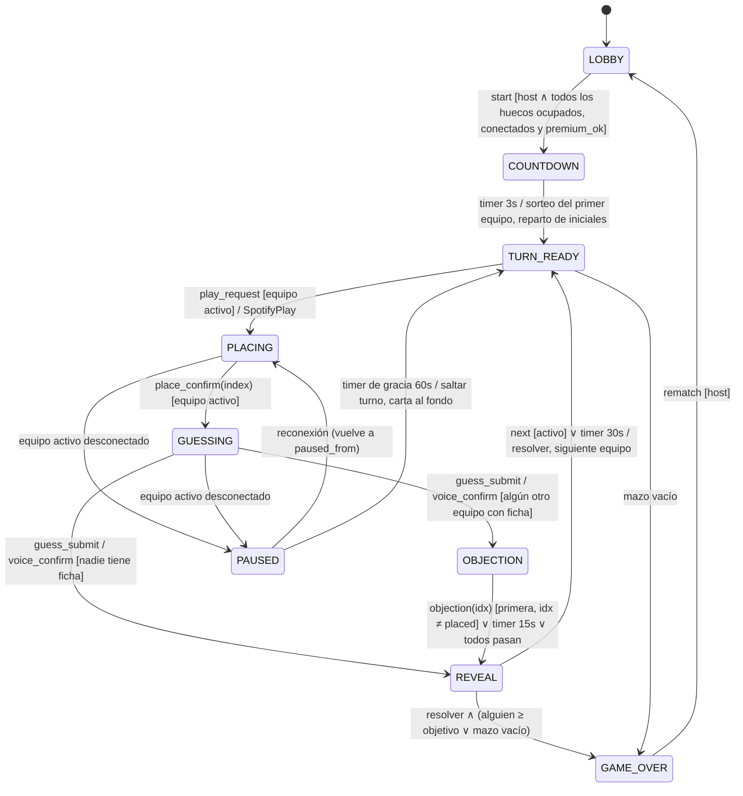
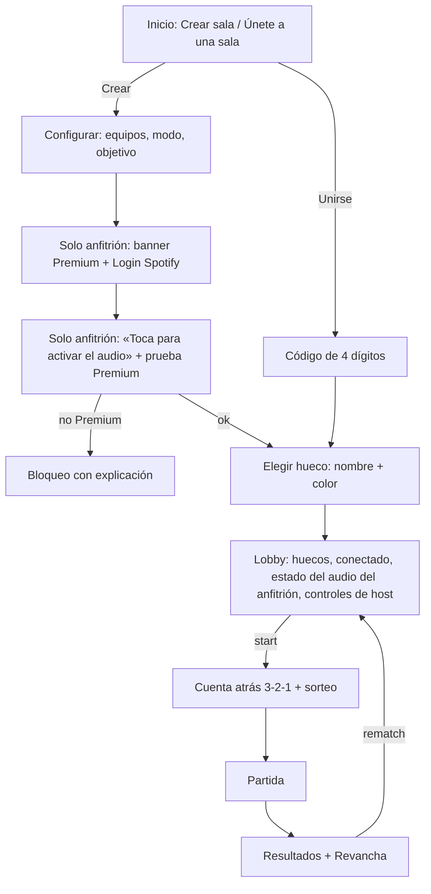
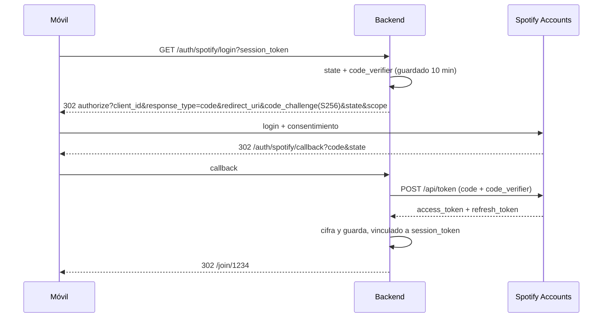

# HitsterCasero — Diseño de solución y plan de desarrollo

## 0. Contexto, supuestos y contradicciones detectadas

**Contexto.** PWA multijugador casera tipo Hitster: 2–4 equipos con un móvil cada uno, una sala con código de 4 dígitos y audio de Spotify en el móvil del equipo activo. Servidor FastAPI autoritativo, estado de sala en memoria y PostgreSQL para el banco de canciones. Prioridad: que funcione bien en 3 móviles reales, no la escala.

### 0.0 Decisiones cerradas por el usuario (prevalecen sobre el resto del documento)

> **Contrato vigente:** `docs/PROTOCOL.md` prevalece sobre §4, §5 y §7.1. Tras la revisión de seguridad (`docs/SECURITY-REVIEW.md`), el WS ya no usa `?token=` (el token va en `hello`) y el login es `POST /api/auth/spotify/start` con cookie de nonce.
| # | Decisión | Consecuencias en el diseño |
|---|---|---|
| D1 | **El móvil del anfitrión reproduce TODAS las canciones** (es la «estación de audio»), sin mostrar nada. Cada equipo coloca desde su propio móvil; cuando le toca al equipo anfitrión, coloca desde ese mismo móvil | Solo el anfitrión hace login en Spotify y necesita Premium. **Los demás móviles no necesitan Spotify**: el paso de login y Premium desaparece del flujo de unión (corrige la regla 3 y la 11). Basta con 1 usuario en el dashboard y el límite de 5 deja de importar. `audio_target = "host_device"` fijo. El botón «Reproducir canción» sigue en el móvil del equipo activo, pero el servidor reproduce en el `device_id` del anfitrión |
| D2 | La ficha de objeción se gasta **siempre** (`always`) | `objection_cost` fijo en `always` (sin opción en la UI) |
| D3 | La carta inicial **cuenta** para el objetivo | `initial_card_counts=true` fijo |
| D4 | **No** se expulsa ni sustituye en mitad de la partida | Solo saltar turno por desconexión |
| D5 | La ficha exige **hueco + canción + artista** | `token_requires_correct_slot=true` fijo |
| D6 | **No** se comparte fuera del círculo privado | Uso privado, en modo desarrollo |
| D7 | La preview de Deezer se usa **solo si Spotify falla** | Reserva automática por turno: si `play` falla 2 veces o el SDK del anfitrión no está listo, el servidor cambia ese turno a la preview por proxy, que suena también en el móvil del anfitrión. Opción manual del host: «Usar audio alternativo» |
| D8 | Sin temporizador de colocación | `placement_timeout_s=null` y no se expone en la UI |
| D9 | Las canciones empiezan en el **segundo 10** de forma automática, sin curar un inicio por canción | `start_position_ms=10000` global en Settings. Sin `start_ms` por canción. En la preview de Deezer (30 s) se empieza en 0 |

**Riesgos nuevos de D1 y su mitigación:**
- **Un único punto de fallo.** Si el móvil del anfitrión se queda sin batería o pierde la red, no hay audio para nadie. Se pausa la partida (`PAUSED` con motivo `audio_host_offline`) en lugar de saltar turnos, y se recomienda cargador y wifi.
- **Gesto en un dispositivo distinto.** La orden «Reproducir» la pulsa otro móvil, pero el audio arranca en el del anfitrión. En Android Chrome, desbloquear el elemento una vez (`activateElement` en el `AudioGate` del lobby) basta para el resto de la sesión. **En iPhone es probable que haga falta un toque en el móvil del anfitrión por canción.** Mitigación: si en 1,5 s no llega `paused=false` al móvil del anfitrión, este muestra a pantalla completa «🔊 Toca para que suene» (sin metadatos) y el `resume()` se hace dentro de ese gesto. **Recomendación: que el anfitrión use Android o un portátil.** Se valida en H0.
- **Pantalla del anfitrión.** Debe quedarse en primer plano con la PWA abierta (Wake Lock) para que no aparezcan la pantalla de bloqueo ni la Media Session. Cuando no es su turno, muestra «No es tu turno», como el resto.

### 0.1 Hechos de Spotify contrastados hoy (10-oct-2026)
| Hecho | Fuente | Impacto |
|---|---|---|
| Modo desarrollo (desde el 11-feb-2026 en apps nuevas y el 9-mar-2026 en las existentes): **máximo 5 usuarios por app**, añadidos a mano. **El propietario necesita Premium**; si caduca, la app deja de funcionar | Guía de migración de feb-2026 | Con 4 equipos y cuentas distintas cabemos justo. Recomiendo **una única cuenta Premium compartida** |
| `GET /me` **ya no devuelve `product`** (ni `country` ni `email`) en modo desarrollo | Guía de migración de feb-2026 | **La comprobación de Premium no puede usar `/me`.** Se hace con el SDK (`account_error`) y con una orden de reproducción de prueba (403 `PREMIUM_REQUIRED`). Ver §7.2 |
| `GET /tracks` (en lote) eliminado; `popularity` y `available_markets` eliminados; `external_ids` (ISRC) **restaurado** en marzo de 2026 | Changelogs de feb y mar de 2026 | El script de catálogo hace búsquedas individuales y puede usar el ISRC para verificar el año |
| Búsqueda: `limit` máximo de 10 (antes 50) | Guía de migración de feb-2026 | El script pagina o se conforma con 10 candidatos |
| Cuotas contadas por cuenta de desarrollador (jul-2026); el 429 trae `reason: QUOTA_EXCEEDED` | Changelog de jul-2026 | Hay que limitar el ritmo del script de catálogo |
| Extended quota solo para organizaciones con más de 250 000 MAU (desde may-2025) | Prensa y Spotify | **La app se queda para siempre en modo desarrollo.** No es un producto público |
| Web Playback SDK: Premium (no sirven los planes «solo móvil»). En iOS **la reproducción no arranca sola tras transferir; necesita interacción**. Prohibido el uso comercial sin permiso | Documentación del Web Playback SDK | Confirma el riesgo en iPhone. Uso privado y no comercial |
| `preview_url` (30 s) es `null` en apps creadas desde nov-2024 (conocido; no se ha vuelto a comprobar hoy) | Changelog de nov-2024 | **El plan B de 30 s no puede salir de Spotify.** Ver §7.6 |
| Redirect URI: HTTPS obligatorio, salvo loopback `http://127.0.0.1` (no `localhost`) | Política de redirect URI de 2025 | En desarrollo con móviles hace falta HTTPS: un túnel o Caddy con dominio |

### 0.2 Supuestos tomados (la opción más simple; todos configurables)
- S1. La carta inicial **cuenta** para el objetivo, como en el Hitster original (10 cartas = inicial + 9). Se configura con `initial_card_counts`.
- S2. Las fichas iniciales son 0 (`initial_tokens`).
- S3. Objeción con el modelo original: el objetor **elige otro hueco** en la línea del equipo activo. **La ficha se gasta siempre** (`objection_cost=always|on_fail`, por defecto `always`; tu propuesta, `on_fail`, queda como opción). Vale la primera objeción recibida y esta cierra la ventana. Si el activo falla y el objetor acierta, el objetor **roba** la carta y se inserta automáticamente en su posición correcta de su propia línea.
- S4. La ventana de objeción dura 15 s y se salta si ningún otro equipo tiene ficha.
- S5. Temporizador de colocación desactivado por defecto (`placement_timeout_s=null`). Revelación visible un mínimo de 5 s; luego el equipo activo pulsa «Siguiente» (auto a los 30 s).
- S6. Banco agotado: la partida termina. Gana quien tenga más cartas; en caso de empate, más fichas; si persiste, empate compartido.
- S7. Desconexión del equipo activo: gracia de 60 s con la partida en pausa; si no vuelve, se salta el turno y la carta vuelve al fondo del mazo.
- S8. Si el anfitrión se desconecta en el lobby más de 30 s, los controles pasan al siguiente hueco ocupado.
- S9. Las cartas iniciales se reparten con una separación mínima de 5 años entre equipos, para que las referencias sean útiles.
- S10. Idioma: solo español.

### 0.3 Puntos contradictorios o arriesgados de tu diseño y propuesta
1. **«Suena en ese móvil» frente a iPhone.** Es el mayor riesgo del proyecto: el SDK en Safari iOS y en PWA instalada es poco fiable (EME/FairPlay, gestos, se corta al bloquear). **Alternativa:** añadir un modo **«Estación de audio»**, un portátil o PC con el navegador abierto en `/station` que reproduce todas las canciones, sea cual sea el equipo activo. Es configurable por sala y se valida en el Hito 0.
2. **Comprobar Premium «de verdad».** Ya no es posible con `/me` (ver 0.1). Se sustituye por SDK `ready` sin `account_error`, más una transferencia de reproducción al dispositivo que no devuelva 403.
3. **Cuenta compartida y metadatos visibles.** Con una sola cuenta, **cualquier app de Spotify abierta con esa cuenta (en un móvil, un PC o un reloj) muestra «Reproduciendo ahora» con título y artista**. Mitigación: aviso en el lobby («cerrad la app de Spotify») y el SDK como único dispositivo activo. Con cuentas distintas no pasa, pero el límite es de 5 usuarios.
4. **El antitrampas es total en nuestros payloads, pero no frente a quien abra las herramientas de desarrollo.** El SDK necesita un access token en el cliente, y su evento `player_state_changed` incluye `current_track.name`. Diseño: **el servidor ordena la reproducción** (el cliente nunca recibe la URI) y el cliente ignora y no registra el estado del SDK. Es suficiente para un juego casero, y conviene asumirlo así.
5. **Modal de voz alta.** «¿Habéis dicho bien canción y artista?» *antes* de revelar no tiene sentido, porque nadie lo sabe aún. **Propuesta:** antes de revelar, «¿Confirmáis hueco y respuesta? Vamos a comprobar el año». **Después** de revelar, «¿Acertasteis canción y artista?» (por honor), que es lo que decide la ficha.
6. **Ficha con «año + canción + artista».** En el Hitster original basta con canción y artista. Mantengo tu regla, porque es más exigente y crea menos fichas, pero la dejo configurable (`token_requires_correct_slot=true`).
7. **«Dar por bueno» en modo app** convierte la validación en honor. Es aceptable, pero el botón se muestra **a todos los móviles** durante la revelación para que sea transparente.
8. **Objeción y su interfaz.** Los demás móviles ven la línea «en solo lectura», pero para objetar necesitan elegir un hueco. Durante `OBJECTION_WINDOW`, los equipos con ficha pasan a un modo interactivo.
9. **Límite de 5 usuarios y PKCE.** Si cada equipo usa una cuenta propia, todas deben estar dadas de alta en el dashboard. El flujo de unión lo detecta (error 403 «user not registered») con un mensaje claro.
10. **Redis no hace falta.** Ver §1.3.

---

## 1. Arquitectura

### 1.1 Componentes


### 1.2 Principios
- **Motor puro:** `reduce(state, command, now) -> (state, effects)`, sin E/S. Los efectos (`Broadcast`, `StartTimer`, `SpotifyPlay`, `PersistSnapshot`) los ejecuta el `RoomRuntime`. Se prueba al 100 % sin red.
- **Un `asyncio.Lock` por sala** serializa los comandos; los temporizadores son `asyncio.Task` que inyectan comandos `TimerFired(timer_id)` y se ignoran si el id ha caducado.
- **Proyección por destinatario:** `project(state, viewer_team_id) -> RoomView`. Es el único sitio donde se decide qué se oculta, y tiene tests específicos.
- **El servidor ordena la reproducción** con `PUT /v1/me/player/play?device_id=…` y el token del usuario del equipo activo. La URI nunca sale del servidor.

### 1.3 Memoria frente a Redis
**En memoria, un solo proceso de uvicorn (1 worker).** Con pocas salas y pocos usuarios, Redis añade un componente, serialización y pub/sub sin aportar nada. Para no perder partidas en un reinicio o despliegue, se guarda un **snapshot JSON en PostgreSQL** (`room_snapshots`) en cada cambio de fase y se restaura al arrancar. Redis solo tendría sentido con varias réplicas, que están fuera de alcance.

---

## 2. Modelo de datos

### 2.1 PostgreSQL
```sql
CREATE TABLE songs (
  id              SERIAL PRIMARY KEY,
  csv_id          TEXT UNIQUE NOT NULL,
  title           TEXT NOT NULL,          -- título canónico para mostrar
  artist          TEXT NOT NULL,          -- artista canónico
  year            SMALLINT NOT NULL CHECK (year BETWEEN 1950 AND 2100),
  year_status     TEXT NOT NULL DEFAULT 'pending'
                  CHECK (year_status IN ('pending','verified','ambiguous','disputed')),
  year_note       TEXT,                    -- p. ej. "single 1985; reentrada en listas 2022"
  title_aliases   TEXT[] NOT NULL DEFAULT '{}',  -- p. ej. {'Un año más'}
  artist_aliases  TEXT[] NOT NULL DEFAULT '{}',  -- p. ej. {'Queen'} para colaboraciones
  genre           TEXT,                    -- pop|rock|dance|latin|indie...
  origin          TEXT CHECK (origin IN ('es','intl')),
  spotify_track_id TEXT,
  spotify_album_date TEXT,                 -- release_date bruto (solo informativo)
  isrc            TEXT,
  mb_first_release TEXT,                   -- fecha MusicBrainz (verificación)
  match_confidence REAL,
  match_flags     TEXT[] NOT NULL DEFAULT '{}',  -- {'remaster','live','compilation','year_mismatch'}
  enabled         BOOLEAN NOT NULL DEFAULT false, -- solo verified + track_id
  fallback_preview_ref TEXT,               -- id para el plan B (Deezer)
  updated_at      TIMESTAMPTZ NOT NULL DEFAULT now()
);
CREATE INDEX ON songs (enabled, year);

CREATE TABLE room_snapshots (           -- recuperación tras reinicio
  code TEXT PRIMARY KEY, state JSONB NOT NULL, updated_at TIMESTAMPTZ NOT NULL DEFAULT now()
);
CREATE TABLE spotify_sessions (         -- tokens cifrados con Fernet, TTL 12 h
  session_id UUID PRIMARY KEY, spotify_user_id TEXT, access_token BYTEA,
  refresh_token BYTEA, expires_at TIMESTAMPTZ, premium_verified BOOLEAN DEFAULT false,
  created_at TIMESTAMPTZ DEFAULT now()
);
```
No hay tablas de usuarios ni de historial (fuera de alcance).

### 2.2 Estado de sala en memoria (Pydantic)
```python
class Phase(StrEnum):
    LOBBY="lobby"; COUNTDOWN="countdown"; TURN_READY="turn_ready"; PLACING="placing"
    GUESSING="guessing"; OBJECTION="objection"; REVEAL="reveal"; PAUSED="paused"; GAME_OVER="game_over"

class Settings(BaseModel):
    team_count: int = 2                  # 2..4
    mode: Literal["app","voice"] = "voice"
    target_cards: int = 10
    initial_card_counts: bool = True
    initial_tokens: int = 0
    objection_window_s: int = 15
    objection_cost: Literal["always"] = "always"          # D2
    token_requires_correct_slot: bool = True              # D5
    placement_timeout_s: None = None                      # D8
    disconnect_grace_s: int = 60
    start_position_ms: int = 10_000                       # D9
    audio_source: Literal["spotify","preview"] = "spotify" # D7: preview solo como reserva

class AudioHost(BaseModel):          # D1: el móvil del anfitrión es la única salida de audio
    spotify_session_id: UUID | None; device_id: str | None
    sdk_ready: bool = False; premium_ok: bool = False; unlocked: bool = False

class Card(BaseModel):            # solo existe en el servidor
    instance_id: str              # opaco y aleatorio por partida (no es song_id)
    song_id: int; title: str; artist: str; year: int; track_id: str

class Team(BaseModel):
    slot: int; name: str | None; color: str | None
    session_token_hash: str | None       # token de sesión del móvil (sha256)
    connected: bool = False              # sin Spotify por equipo (D1)
    timeline: list[Card] = []            # ordenada por año
    tokens: int = 0

class Turn(BaseModel):
    team_slot: int; card: Card
    placed_index: int | None = None      # hueco 0..len(timeline)
    guess_title: str | None = None; guess_artist: str | None = None
    objection: tuple[int, int] | None = None   # (slot objetor, índice)
    result: "TurnResult | None" = None
    started_playing: bool = False

class Room(BaseModel):
    code: str; host_slot: int = 0; settings: Settings; audio: AudioHost
    phase: Phase; paused_from: Phase | None = None
    teams: list[Team]; deck: list[Card]; turn: Turn | None
    first_slot: int | None; turn_no: int = 0
    timers: dict[str, "TimerRef"] = {}; version: int = 0  # versión monotónica
    winner_slots: list[int] = []
```
**Regla de hueco correcto:** si se inserta en el índice `i` de una línea ordenada `t`, es correcto si `t[i-1].year <= y` (o `i == 0`) y `y <= t[i].year` (o `i == len`). Así, los años iguales valen a ambos lados.

---

## 3. Máquina de estados



### 3.1 Guardas y efectos clave
| Transición | Guarda | Efectos |
|---|---|---|
| `start` | emisor = host; `len(ocupados) == team_count`; todos `connected`; `audio.sdk_ready ∧ audio.premium_ok ∧ audio.unlocked` (D1) | cierra la sala; `first_slot = random`; reparte 1 carta inicial (S9); `initial_tokens` |
| `play_request` | fase `TURN_READY` (o `PLACING`, para repetir); emisor = activo (puede ser cualquier móvil) | `SpotifyPlay(audio.device_id, track_id, position_ms=start_position_ms)` **en el móvil del anfitrión**; `audio_command{prepare}` al anfitrión. Tras 2 fallos, `audio_source=preview` para ese turno (D7) y `audio_command{play_preview}` al anfitrión |
| `place_confirm` | `0 ≤ idx ≤ len(timeline)` | guarda `placed_index` |
| `objection` | emisor ≠ activo; `tokens > 0`; `idx ≠ placed_index`; ventana abierta | gasta la ficha según `objection_cost`; cierra la ventana |
| Resolver (al entrar en `REVEAL`) | — | `SpotifyPause` opcional; calcula `TurnResult` (ver abajo) |
| `honor_claim` / `accept_guess` | fase `REVEAL`; emisor activo (o cualquiera para `accept_guess`) | recalcula el reparto de la ficha |

**Resolución del turno:**
1. Si `placed` es correcto, la carta va a la línea del activo (y el objetor pierde la ficha, aunque el coste sea `on_fail`).
2. Si no, y hay objeción con `idx` correcto, la carta va a la línea del objetor en su posición correcta.
3. Si no, la carta se descarta.

**Ficha:** `+1` al activo si `placed` es correcto (cuando `token_requires_correct_slot`) y si el título y el artista son correctos (validación automática, «dar por bueno» o reclamación por honor en modo voz). Se puede corregir hasta salir de `REVEAL`.

### 3.2 Temporizadores
| Id | Duración | Al vencer |
|---|---|---|
| `countdown` | 3 s | `TURN_READY` |
| `placement` | `placement_timeout_s` (desactivado) | coloca en el hueco actual del carrusel |
| `objection` | 15 s | `REVEAL` |
| `reveal_auto` | 30 s (mínimo de 5 s antes de permitir `next`) | `next` |
| `grace:{slot}` | 60 s | saltar turno (si es el activo) |
| `lobby_host` | 30 s | migración de host |
| `room_gc` | 2 h sin actividad / 15 min en `GAME_OVER` sin revancha | destruir la sala y su snapshot |

Los temporizadores guardan `deadline_ts` (epoch del servidor) en la vista, de modo que el cliente pinta una cuenta atrás fiable.

### 3.3 Casos límite
- **Desconexión del activo:** `PAUSED` (el temporizador de objeción se congela si está corriendo). Reconexión con `session_token`: reanuda y emite `snapshot`. La música no se reanuda sola: el móvil vuelve a mostrar «Reproducir canción».
- **El móvil del anfitrión (audio) se desconecta o pierde el SDK (D1):** cualquier fase de juego pasa a `PAUSED{reason:"audio_host_offline"}` sin temporizador de salto. Los demás ven «Esperando al móvil del anfitrión (audio)». Al volver, el anfitrión pasa por el `AudioGate` y la partida se reanuda.
- **Desconexión de otro equipo:** el juego sigue. Si le toca su turno estando desconectado, gracia de 60 s y después se salta.
- **Todos desconectados:** la sala sigue viva hasta `room_gc`.
- **Empate de objeciones:** gana el orden de llegada al lock de la sala. La segunda recibe `error{code:"objection_closed"}` y no gasta ficha.
- **Objeción al mismo hueco que el activo:** se rechaza en el cliente y en el servidor.
- **Banco agotado:** al entrar en `TURN_READY` con el mazo vacío, va a `GAME_OVER` con `reason:"deck_exhausted"` (S6). Aviso previo cuando quedan menos de 5 cartas.
- **Expulsión:** solo en `LOBBY` y por el host. Libera el hueco, revoca el `session_token` y envía `kicked` al expulsado. En partida no se expulsa (decisión abierta D4).
- **Cambio de `team_count`:** solo en `LOBBY` y nunca por debajo de los huecos ocupados.
- **Revancha:** se conservan los equipos, los tokens y los dispositivos; se baraja un mazo nuevo **sin repetir las canciones ya usadas en la sala** mientras queden.
- **El SDK pierde el dispositivo (iOS en segundo plano):** `audio_error{code:"device_gone"}`. Se muestra «Toca para reconectar audio», que reinicializa el SDK y reintenta.
- **Reinicio del servidor:** se restaura el snapshot y los temporizadores se reprograman a partir de `deadline_ts`. Los clientes reconectan con backoff.

---

## 4. Contrato de tiempo real (WebSocket)

Ruta `wss://host/ws/rooms/{code}?token={session_token}`. Sobre: `{"type": str, "id": uuid, "payload": {...}}`. El servidor responde con `ack{ref_id}` o con `error{ref_id, code, message}`. Cada cambio emite `state{version, view}`, la vista completa proyectada para ese destinatario; con 4 clientes y menos de 5 KB es más simple que mandar diferencias. Además se envían eventos efímeros para animaciones y sonido.

### 4.1 Cliente → servidor
| type | payload | Fase / quién |
|---|---|---|
| `hello` | `{session_token, last_version}` | siempre (reconexión) |
| `claim_slot` | `{slot, name, color}` | LOBBY |
| `device_ready` | `{device_id, provider:"sdk"\|"connect"\|"preview"}` | LOBBY y en partida |
| `kick` | `{slot}` | LOBBY, host |
| `update_settings` | `Partial<Settings>` | LOBBY, host |
| `start_game` | `{}` | LOBBY, host |
| `play_request` | `{}` | TURN_READY/PLACING, activo |
| `place_preview` | `{index}` | PLACING, activo (los demás lo ven en directo; con limitación de frecuencia) |
| `place_confirm` | `{index}` | PLACING, activo |
| `guess_submit` | `{title, artist}` | GUESSING, activo, modo app |
| `voice_confirm` | `{}` | GUESSING, activo, modo voz |
| `objection` | `{index}` | OBJECTION, otros equipos con ficha |
| `objection_pass` | `{}` | OBJECTION |
| `honor_claim` | `{title_ok: bool, artist_ok: bool}` | REVEAL, activo, modo voz |
| `accept_guess` | `{}` | REVEAL, activo, modo app («Dar por bueno») |
| `next_turn` | `{}` | REVEAL, activo |
| `rematch` | `{}` | GAME_OVER, host |
| `ping` | `{t}` | cada 15 s |

### 4.2 Servidor → cliente
| type | payload |
|---|---|
| `state` | `{version, view: RoomView}` |
| `countdown` | `{deadline_ts, first_slot}` |
| `audio_command` | **Solo al móvil del anfitrión:** `{action:"prepare"\|"tap_required"\|"play_preview"\|"stop"}`. Nunca contiene la URI; la preview se pide a `/api/turn/audio` con el token de sesión del anfitrión |
| `audio_status` | A todos: `{playing: bool, source:"spotify"\|"preview"}` (para que el activo vea «Sonando…») |
| `audio_error` | `{code:"premium_required"\|"device_gone"\|"rate_limited"\|"unknown", retry: bool}` |
| `reveal` | `{card: CardPublic, correct_slot: bool, objection_result, guess_auto: {title_ok, artist_ok, score}}` |
| `turn_resolved` | `{to_slot\|null, token_delta: {slot: n}}` |
| `kicked` | `{reason}` |
| `game_over` | `{winners: [slot], reason:"target"\|"deck_exhausted", standings}` |
| `error` | `{ref_id, code, message}` |
| `pong` | `{t, server_ts}` (para corregir el desfase de reloj) |

### 4.3 `RoomView` y ocultación por fase
```ts
type CardPublic = { instanceId: string; year: number; title: string; artist: string }; // solo cartas ya reveladas
type MysteryCard = { instanceId: string; hidden: true };                                 // la carta en juego
interface RoomView {
  code: string; phase: Phase; settings: Settings; you: { slot: number | null; isHost: boolean };
  teams: { slot: number; name?: string; color?: string; connected: boolean; premiumOk: boolean;
           timeline: CardPublic[]; tokens: number; cardCount: number }[];
  turn?: { teamSlot: number; card: MysteryCard | CardPublic; placedIndex?: number; previewIndex?: number;
           objection?: { slot: number; index: number }; deadlineTs?: number;
           guess?: { title: string; artist: string } };  // solo en REVEAL
  deckRemaining: number; winners?: number[];
}
```
| Campo de la carta en curso | LOBBY…GUESSING | OBJECTION | REVEAL / GAME_OVER |
|---|---|---|---|
| `title`, `artist`, `year` | **nunca** | **nunca** | sí |
| `track_id` / URI / portada | **nunca** | **nunca** | **nunca** (no hacen falta) |
| `song_id` | **nunca** (solo el `instanceId` aleatorio) | **nunca** | **nunca** |
| `guess` del activo | solo a su propio móvil | solo a su propio móvil | a todos |
| `deck` | solo `deckRemaining` | igual | igual |

Un test de contrato serializa la vista de cada fase y comprueba que no aparecen cadenas del título, del artista ni del año de la carta en curso.

---

## 5. API REST (FastAPI, prefijo `/api`)
| Método y ruta | Descripción | Respuesta |
|---|---|---|
| `POST /session` | Crea la identidad de sesión del móvil (sin cuenta) | `{session_token}` (32 bytes aleatorios en base64url; el servidor guarda el hash) |
| `GET /auth/spotify/login?session_token=…&return_to=/join/1234` | Genera `state` y `code_verifier` (PKCE S256) y redirige a `accounts.spotify.com/authorize` | 302 |
| `GET /auth/spotify/callback?code&state` | Intercambia el código con el verifier y guarda los tokens cifrados vinculados a la sesión | 302 → `return_to` |
| `GET /auth/spotify/token` (Bearer session) | Access token vigente para el `getOAuthToken` del SDK; refresca si quedan menos de 5 min | `{access_token, expires_at}` |
| `POST /auth/spotify/verify-premium` `{device_id}` | Transfiere la reproducción al dispositivo con `play:false`: 204 → OK; 403 `PREMIUM_REQUIRED` → no Premium | `{premium: bool, reason?}` |
| `POST /auth/logout` | Revoca la sesión local | 204 |
| `POST /rooms` `{settings}` | Crea la sala (código de 4 dígitos sin colisión entre las activas; el emisor ocupa el hueco 0 como host) | `{code, ws_url}` |
| `GET /rooms/{code}` | Prejoin: existe, está abierta, huecos libres con color sugerido, modo | `{status:"open"\|"started"\|"full", slots:[…], mode}` |
| `GET /catalog/stats` | Número de canciones habilitadas por década y origen | `{total, by_decade, by_origin}` |
| `GET /admin/songs?status=` (token de admin en env) | Revisión del catálogo | lista |
| `PATCH /admin/songs/{id}` | Fijar año, estado y alias, y habilitar | canción |
| `GET /healthz` | Liveness | 200 |

Para los códigos de sala: 10 000 combinaciones; se reintenta hasta encontrar uno libre y se limita la creación por IP (5 por minuto). Contra la fuerza bruta en `GET /rooms/{code}` y en el WS: 20 intentos por minuto por IP.

---

## 6. Frontend

**Stack:** Vite, React 18, TypeScript, Zustand (store derivado del `RoomView`), React Router, `vite-plugin-pwa` (Workbox), Embla Carousel para el carrusel táctil, Tailwind y Framer Motion (revelación). Sin librería de UI pesada.

### 6.1 Pantallas y navegación

Ruta `/station`: estación de audio (solo login y SDK, pantalla negra con «🔊 Estación lista»).

### 6.2 Estados de la pantalla de partida (por rol)
| Fase | Equipo activo | Otros equipos |
|---|---|---|
| TURN_READY | Botón grande «▶ Reproducir canción» | «No es tu turno — le toca a {Equipo}» + línea en solo lectura |
| PLACING | Carrusel con la carta misteriosa fija en el centro, «Repetir», «Anclar aquí» | Línea del activo con un indicador del hueco en directo (`place_preview`) |
| GUESSING | App: modal con título y artista. Voz: modal «¿Confirmáis hueco y respuesta? Vamos a comprobar el año» | «Pensando…» |
| OBJECTION | «Esperando objeciones (15 s)» | Con ficha: banner «¿Objetáis?», el carrusel se vuelve interactivo, «Objetar aquí» y «Pasar». Sin ficha: cuenta atrás |
| REVEAL | Volteo de la carta: año, título y artista; ✓/✗; voz: «¿Acertasteis canción y artista?» Sí/No; app: resultado y «Dar por bueno»; «Siguiente» | La misma revelación |
| PAUSED | «Reconectando…» | «{Equipo} se ha desconectado (52 s)» |

### 6.3 Componentes clave
- **`TimelineCarousel`** `{cards, mode:"readonly"|"place"|"object", mysteryCard?, selectedIndex, onIndexChange, blockedIndex?}`. Diseño: **la carta misteriosa queda fija en el centro y es la línea la que se desliza** (snap por huecos), en lugar de arrastrar la carta. Funciona mejor con el dedo, es accesible (basta con botones ◀ ▶) y no hay conflictos entre gestos de arrastre y desplazamiento. Los huecos se muestran como «antes de 1985», «entre 1985 y 1992» o «después de 2003».
- **`MysteryCard`**: logo y reverso. Animación de volteo en `REVEAL`.
- **`TeamPanel`**: color, nombre, contador `x/10` con barra, fichas (🪙 × n) y punto de conexión.
- **`GuessModal`** (app): dos inputs con `autocomplete=off` y `autocapitalize`, «Enviar» y «No lo sé».
- **`VoiceConfirmModal`**, **`HonorClaimModal`**, **`ObjectionBanner`** (cuenta atrás circular).
- **`AudioGate`**: pantalla de «Toca para activar el audio» (gesto, `activateElement`).
- **`HostControls`** (lobby): stepper de equipos, expulsar ✕ y modo.
- **`ConnectionBanner`**: reconexión con backoff exponencial (0,5 s → 8 s).

### 6.4 Accesibilidad
Contraste AA y colores de equipo con **icono y nombre**, nunca solo color (4 paletas aptas para daltónicos con forma: ● ▲ ■ ◆). Objetivos táctiles de al menos 48 px. El carrusel usa `role="listbox"` con `aria-live` para anunciar el hueco («Entre 1985 y 1992»), y los botones ◀ ▶ son una alternativa al deslizamiento. Se respeta `prefers-reduced-motion`. Vibración (`navigator.vibrate`) al cambiar de turno, que se puede desactivar. Pantalla activa con `navigator.wakeLock.request('screen')` durante la partida.

### 6.5 PWA
Manifest con `display: standalone`, iconos de 192, 512 y maskable, `theme_color` y `start_url: /`. El service worker cachea solo el shell; **la API, el WS y el SDK nunca se cachean**. El SDK se carga desde `https://sdk.scdn.co/spotify-player.js` en tiempo de ejecución. En iOS, si la PWA instalada falla en el Hito 0, **se recomienda jugar desde Safari, no instalada**, y se muestra un aviso según `display-mode`. Se guardan `session_token` y `room_code` en `localStorage` para reconectar.

---

## 7. Integración con Spotify

### 7.1 OAuth (Authorization Code con PKCE, intermediado por el backend)

Scopes: `streaming user-read-private user-read-playback-state user-modify-playback-state`. ¿Por qué en el backend? Porque **el servidor necesita el token para ordenar la reproducción sin dar la URI al cliente**. PKCE se mantiene (no hace falta exponer el client_secret, y en dev se puede usar sin secret).

> **Con D1, todo §7 aplica solo al móvil del anfitrión.** Los demás móviles nunca cargan el SDK ni hacen login. Las menciones a «el móvil del activo» o a «modo Estación» en §7 se leen como «el móvil del anfitrión».

### 7.2 Comprobación de Premium (dos capas, porque `/me.product` ya no existe)
1. Banner previo: «Necesitas Spotify Premium (no valen los planes solo móvil)».
2. Inicializar el SDK y comprobar los listeners: `account_error` → no Premium (bloqueo), `authentication_error` → volver a hacer login, `initialization_error` → navegador no soportado, por lo que se ofrece plan B.
3. Con `ready(device_id)`, llamar a `POST /auth/spotify/verify-premium`: el backend hace `PUT /v1/me/player {device_ids:[id], play:false}`. Un 403 `PREMIUM_REQUIRED` bloquea. Si es correcto, `premium_ok=true` en el hueco.
4. Error 403 «user not registered» (cuenta no dada de alta en el dashboard): mensaje «Pide al anfitrión que añada tu email en el panel de Spotify o usad la cuenta compartida».

### 7.3 Inicialización del SDK y reproducción
```ts
interface AudioProvider {
  readonly kind: "sdk" | "connect" | "preview" | "station" | "fake";
  init(getToken: () => Promise<string>): Promise<{ deviceId?: string }>;
  unlock(): Promise<void>;          // llamar DENTRO del gesto del usuario
  onServerPlay(): void;              // para la UI (estado sonando)
  pause(): Promise<void>;
  onError(cb: (e: AudioError) => void): void;
  dispose(): void;
}
```
Flujo con `SdkAudioProvider`:
- `new Spotify.Player({ name: "HitsterCasero · {equipo}", getOAuthToken: cb => fetchToken().then(cb), volume: 0.8 })` y `connect()`.
- En el lobby, el `AudioGate` del anfitrión (gesto) llama a `player.activateElement()` y deja `audio.unlocked=true`.
- El botón «Reproducir canción» está en el **móvil del equipo activo** y solo envía `play_request`. El servidor hace `PUT /me/player/play?device_id={anfitrión} {uris:[track], position_ms:10000}` (D9). Si en 1,5 s el SDK del anfitrión no informa `paused=false`, el servidor envía `audio_command{tap_required}` al anfitrión, que muestra «🔊 Toca para que suene» y llama a `player.resume()` dentro del gesto (caso previsto en iOS). Se valida en H0.
- `player_state_changed`: **solo se leen `paused`, `position` y `loading`.** El objeto no se registra en logs ni se guarda en el store; hay una regla de ESLint que prohíbe acceder a `track_window`.
- «Repetir»: `play_request` otra vez (el servidor reinicia en `position_ms`).

### 7.4 Ocultar metadatos (pantalla de bloqueo, Media Session)
- Tras cada `player_state_changed` y cada 2 s mientras suena: `navigator.mediaSession.metadata = new MediaMetadata({ title: "🎵 Canción misteriosa", artist: "HitsterCasero", artwork: [{src:"/icon-512.png"}] })`. Hay que **validar en el Hito 0** si el SDK, que reproduce dentro de su propio iframe o elemento, publica su propia sesión por encima. Si gana el SDK, mitigación: el móvil del activo boca abajo o con la pantalla encendida (Wake Lock, sin bloquear), o el modo estación.
- El nombre del dispositivo del SDK nunca contiene información de la canción.
- Aviso en el lobby: «Cerrad la app de Spotify en todos los móviles y relojes (muestra lo que suena)».
- Al revelar, `pause()` opcional (configurable, por defecto sigue sonando hasta «Siguiente»).

### 7.5 Gestión de errores
| Error | Detección | Acción |
|---|---|---|
| Token caducado | 401 Web API / `authentication_error` | refresh en el backend y reintento una vez |
| Dispositivo no encontrado (404 `NO_ACTIVE_DEVICE`) | Web API | `audio_error{device_gone}` → el cliente reinicializa el SDK y vuelve a enviar `device_ready` |
| 429 / `QUOTA_EXCEEDED` | Web API | backoff con `Retry-After`; mensaje «Spotify limita, espera X s» |
| `playback_error` | SDK | botón de reintento; a la tercera, ofrecer plan B |
| `PREMIUM_REQUIRED` | 403 | bloqueo del hueco |
| Otra app tomó el control (`not_ready`) | SDK | banner «Otro dispositivo usa la cuenta» |

### 7.6 Plan B (proveedores intercambiables)
**Tras D1 y D7:** el proveedor primario es `SdkAudioProvider` en el móvil del anfitrión. Si falla, **se cambia automáticamente** a `PreviewAudioProvider` (Deezer por proxy, en el mismo móvil). La estación en PC y Spotify Connect quedan como alternativas manuales, sin desarrollo en v1 salvo que H0 lo exija.
1. **`StationAudioProvider` (recomendado como plan B principal):** un PC con Chrome en `/station` registra el SDK y el servidor reproduce **siempre en ese device_id**. Los móviles solo hacen de mando. Es la opción más fiable y evita los problemas de iOS y de la pantalla de bloqueo del móvil.
2. **`ConnectAudioProvider`:** el servidor reproduce en un dispositivo Spotify Connect existente (altavoz, TV, PC con la app), elegido de `GET /me/player/devices` en el lobby. Riesgo: la app de Spotify del dispositivo muestra la canción, así que solo vale para altavoces o TVs que no se miren.
3. **`PreviewAudioProvider` (30 s):** Spotify ya no da `preview_url`. Alternativa: **preview de Deezer** (API pública, MP3 de 30 s), cuyo id se obtiene en la importación por ISRC (`/track/isrc:{isrc}`). En cada turno, el **servidor hace de proxy del audio** (`GET /api/turn/audio`, que transmite en streaming el MP3 sin exponer la URL ni el id) y el cliente lo reproduce en `<audio>`, que funciona en todos los navegadores con un gesto. Requisito por confirmar: condiciones de uso de Deezer (D7). Ventaja: no requiere Premium.
4. **`FakeAudioProvider`:** tests y E2E (tono local).

---

## 8. Validación de título y artista (modo app)

### 8.1 Normalización
```python
def normalize(s: str) -> str:
    s = unicodedata.normalize("NFKD", s).encode("ascii","ignore").decode().lower()
    s = re.sub(r"\(.*?\)|\[.*?\]", " ", s)                     # (Remastered 2011), [Live]
    s = re.split(r"\s+-\s+", s)[0]                              # " - 2011 Remaster"
    s = re.sub(r"\b(feat|ft|featuring|con|with)\b\.?.*$", " ", s) # colaboraciones
    s = s.replace("&", " y ").replace(" and ", " y ")
    s = re.sub(r"[^a-z0-9 ]", " ", s)
    tokens = [t for t in s.split() if t not in {"the","a","an","el","la","los","las","un","una","lo"}]
    return " ".join(tokens)
```
### 8.2 Coincidencia (`rapidfuzz`)
`match(guess, canonical, aliases)`:
1. Si `norm(guess)` está vacío, es incorrecto.
2. Si es igual a `norm(c)` para `c` en `[canonical, *aliases]`, es correcto.
3. Se calcula `ratio = fuzz.ratio(ng, nc)` y la distancia `d = Levenshtein.distance(ng, nc)`. Es correcto si `d ≤ max(1, len(nc)//6)` **o** `ratio ≥ 88`.
4. **Solo para el título:** si `fuzz.token_set_ratio ≥ 92` y `len(ng) ≥ 0.6·len(nc)`, es correcto (cubre un orden distinto o palabras omitidas en títulos largos).
5. **Artista:** se divide el canónico por `,`, `&`, `y`, `feat`, `x`. Basta con acertar **cualquiera de los artistas principales**.
Los umbrales van en la configuración. «Dar por bueno» siempre está disponible.

### 8.3 Casos de prueba (parametrizados con pytest)
| Canónico | Intento | Esperado | Motivo |
|---|---|---|---|
| Despacito / Luis Fonsi, Daddy Yankee | `despasito` / `daddy yanki` | ✓ / ✓ | distancia 1 y 1 artista |
| Bohemian Rhapsody / Queen | `bohemian rapsody` / `queen` | ✓ | distancia 1 |
| Mediterráneo / Joan Manuel Serrat | `mediterraneo` / `serrat` | ✓ / ✓ | tilde; token_set del artista |
| La Bamba / Los Lobos | `bamba` / `lobos` | ✓ / ✓ | artículos |
| Don't Stop Me Now / Queen | `dont stop me now` | ✓ | puntuación |
| Billie Jean / Michael Jackson | `billy jean` / `michael jakson` | ✓ / ✓ | distancia 1 |
| Get Lucky / Daft Punk feat. Pharrell Williams | `get lucky` / `pharrell` | ✓ / ✓ | feat. y artista secundario aceptado |
| Hijo de la Luna / Mecano | `hijo de luna` / `mecano` | ✓ | token_set |
| Hijo de la Luna / Mecano | `hijos del sol` | ✗ | demasiado distinto |
| Entre dos aguas / Paco de Lucía | `entre dos tierras` | ✗ | **otra canción real** (Héroes del Silencio): ratio < 88 |
| Like a Prayer / Madonna | `like a virgin` | ✗ | otra canción real |
| Insurrección / El Último de la Fila | `insureccion` / `el ultimo de la fila` | ✓ | distancia 1 |
| Rolling in the Deep / Adele | `rolling deep` | ✓ | token_set ≥ 92 con longitud ≥ 60 % |
| Y.M.C.A. / Village People | `ymca` | ✓ | puntuación |
| Mi gran noche / Raphael | `raphael` (en el título) | ✗ | campo cruzado |
| Bad Romance / Lady Gaga | `` | ✗ | vacío |
| Sweet Child O' Mine / Guns N' Roses | `sweet child of mine` / `guns and roses` | ✓ / ✓ | `n'`→`and`→`y`; distancia baja |
| Wonderwall / Oasis | `wonderwal` | ✓ | distancia 1 |

---

## 9. Estrategia de pruebas
| Nivel | Herramienta | Contenido |
|---|---|---|
| Unitarias del motor | pytest + **Hypothesis** | cada transición y guarda; regla de hueco con años iguales; resolución con objeción (4 combinaciones activo/objetor ✓✗); fichas según `objection_cost`; banco agotado; empate final; `PAUSED`/reanudar; expulsión; revancha sin repetir. Propiedades: las líneas siempre ordenadas; la suma de cartas se conserva (mazo + líneas + descartes = total); nunca hay más de un ganador por objetivo |
| Proyección y antitrampas | pytest | para cada fase y cada espectador, `json.dumps(view)` no contiene el título, el artista, el año, el `track_id` ni el `song_id` de la carta en curso |
| Temporizadores | pytest con reloj inyectado (`now` en el reducer) | objeción a los 15 s, gracia, `reveal_auto` y restauración desde snapshot |
| Integración WS | `httpx` + `websockets` y la app con TestClient | creación, unión, reconexión con token, objeciones concurrentes (dos clientes con `asyncio.gather`: una gana y la otra recibe `objection_closed`) |
| **Simulación con bots** | script `sim/run_bots.py` | N partidas por cada combinación (2–4 equipos, modos y configuraciones) con bots aleatorios u «oráculo» y desconexiones aleatorias. Afirma que toda partida termina, sin excepciones ni bloqueos (timeout por partida). 1 000 partidas en CI nocturna |
| Validación de texto | pytest parametrizado (§8.3) | más casos de regresión añadidos durante las pruebas reales |
| Script de catálogo | pytest con respuestas de Spotify grabadas (respx) | puntuación de candidatos y detección de remaster, directo y desajuste de año |
| E2E | **Playwright**, 3 contextos (móvil Pixel e iPhone emulados) con `FakeAudioProvider` y un stub de OAuth (`AUTH_MODE=fake`) | partida completa a 3 en modo voz y en modo app, objeción, desconexión y reconexión del activo, revancha |
| Móviles reales | checklist manual (Hito 0 y Hito 8) | matriz: Android Chrome (pestaña y PWA), iPhone Safari (pestaña y PWA), iPad opcional y PC estación. Casos: primer sonido, «Repetir», pantalla bloqueada, app en segundo plano 30 s, llamada entrante, cambio de wifi a 4G, pantalla de bloqueo y notificación (¿se ven metadatos?), una cuenta compartida en 3 dispositivos, latencia de la orden de reproducción (< 1,5 s p95) |

---

## 10. Repositorio, convenciones y entorno local
```
hitster-casero/
├─ apps/
│  ├─ web/                    # Vite + React + TS
│  │  ├─ src/{app,screens,components,audio,ws,store,lib}/
│  │  ├─ src/audio/{AudioProvider.ts,SdkProvider.ts,StationProvider.ts,PreviewProvider.ts,FakeProvider.ts}
│  │  └─ e2e/                 # Playwright
│  └─ server/                 # FastAPI
│     ├─ app/{main.py,config.py}
│     ├─ app/game/{engine.py,models.py,projection.py,rules.py,timers.py}   # puro
│     ├─ app/rooms/{manager.py,runtime.py,snapshot.py}
│     ├─ app/ws/{router.py,protocol.py}      # modelos Pydantic de los mensajes
│     ├─ app/spotify/{oauth.py,client.py,crypto.py}
│     ├─ app/catalog/{repo.py,validate_guess.py}
│     ├─ app/api/{auth.py,rooms.py,catalog.py,admin.py}
│     ├─ migrations/          # Alembic
│     └─ tests/{unit,integration,sim}/
├─ catalog/
│  ├─ songs.csv               # ID,Canción,Artista,Año (+ columnas opcionales Nota,Alias)
│  ├─ import_spotify.py       # §6 del banco
│  └─ review/                 # dudosas.csv generado
├─ packages/protocol/         # tipos TS generados desde Pydantic (datamodel-code-generator / pydantic2ts)
├─ infra/{docker-compose.yml,docker-compose.dev.yml,Caddyfile}
├─ .env.example
└─ Makefile                   # make dev | test | sim | e2e | import-catalog
```
**Convenciones.** Python 3.12, `uv`, `ruff` y `mypy --strict` en `game/`. TypeScript estricto, ESLint (con regla `no-restricted-properties` para `track_window`) y Prettier. Conventional Commits. Un único contrato fuente: los mensajes WS en Pydantic generan los tipos TS en CI, que falla si hay diferencias. Los nombres del dominio van en inglés en el código y los textos de la UI en español (`i18n/es.ts`).

**Entorno local.**
- `docker compose -f infra/docker-compose.dev.yml up`: Postgres; API con `--reload` en `:8000`; Vite en `:5173`.
- **HTTPS para los móviles:** `cloudflared tunnel --url http://localhost:5173` (con proxy a `/api` y `/ws`), o Caddy con un dominio propio. Se registra en el dashboard de Spotify la redirect URI del túnel con nombre fijo y `http://127.0.0.1:5173/api/auth/spotify/callback` para el escritorio.
- `.env`: `SPOTIFY_CLIENT_ID`, `SPOTIFY_REDIRECT_URI`, `TOKEN_ENC_KEY` (Fernet), `DATABASE_URL`, `ADMIN_TOKEN`, `AUTH_MODE=spotify|fake`, `PUBLIC_ORIGIN`.

**Producción.** Docker Compose en un VPS pequeño (2 vCPU y 2 GB, unos 5 €/mes) con `caddy` (TLS automático; sirve `web/dist` y hace de proxy de `/api` y `/ws`), `api` (uvicorn con **1 worker**) y `postgres` con volumen. Backup diario con `pg_dump` (solo el catálogo importa).

---

## 6 bis. Banco de canciones (importación y año original)

### Distribución objetivo (180 canciones)
1970s: 25 · 1980s: 35 · 1990s: 35 · 2000s: 30 · 2010s: 35 · 2020s: 20. Alrededor de un 40 % españolas y un 60 % internacionales. Géneros: pop, rock, dance/electrónica, latino e indie. Hay que evitar más de 3 canciones del mismo artista y concentraciones de años idénticos.

### Script `catalog/import_spotify.py`
```
uso: import_spotify.py songs.csv --market ES --out review/ [--only-pending] [--musicbrainz]
```
1. Token de la aplicación (Client Credentials) para la búsqueda.
2. Por fila: `GET /v1/search?q=track:"{t}" artist:"{a}"&type=track&market=ES&limit=10` y, si hay menos de 3 resultados, búsqueda libre `"{t} {a}"`. Ritmo de 3 peticiones por segundo; respeta `Retry-After`.
3. **Puntuación de cada candidato:** `0.45·sim(título) + 0.35·sim(artista principal) + 0.20·año` (1 si `|album_year − csv_year| == 0`, 0,5 si es ≤ 1, 0 en otro caso). Penalizaciones: −0,3 si el nombre o el álbum contienen `remaster|live|en directo|en vivo|acoustic|acústico|version|versión|remix|edit|mix|mono|demo|karaoke|instrumental|re-recorded|taylor's version|20xx`; −0,15 si `album_type == compilation`. Bonificación: +0,1 si `album_type in (album, single)` y el año coincide.
4. El mejor candidato se guarda en `spotify_track_id`, `spotify_album_date`, `isrc` y `match_confidence`, junto con los `match_flags`.
5. **Dudosa** si `confidence < 0.75`, hay flags de versión, `|album_year − csv_year| ≥ 1` o el segundo candidato está a menos de 0,05. Se escribe `review/dudosas.csv` con los tres mejores candidatos (id, nombre, álbum, fecha y enlace `open.spotify.com/track/…`) para escuchar y decidir.
6. `--musicbrainz`: con el ISRC, `GET musicbrainz.org/ws/2/isrc/{isrc}?inc=recordings+releases`, máximo 1 petición por segundo y User-Agent propio. Se obtiene el `first-release-date` de la grabación y se guarda en `mb_first_release`.
7. Upsert en `songs`. `enabled = (year_status == 'verified' ∧ track_id)`.

### Cómo garantizar el año original
- **Fuente de verdad: el año del CSV, curado por una persona.** Spotify **no** lo es: su `release_date` es el del álbum que contiene esa pista (remaster, recopilatorio o reedición). Spotify solo aporta el `track_id`.
- **Doble verificación automática:** se compara `csv_year` con el año del álbum en Spotify y con MusicBrainz. Si coinciden los tres → `verified`. Si solo coincide MusicBrainz y Spotify es posterior con flag de remaster o recopilatorio → `verified` (es lo esperado). En cualquier otro caso → `disputed`, para revisión manual en `/admin`.
- **Preferir la pista del álbum o single original** aunque suene «remasterizada» (el audio es el mismo): mejor `track_id` con álbum original que un recopilatorio. **Nunca directos ni regrabaciones.**
- **Regla de año ambiguo, escrita en la UI de ayuda:** «Año de la primera publicación comercial de **esa grabación**: single o álbum, lo que salga antes».
  - Single de finales de año con álbum al año siguiente: año del single.
  - Reentradas en listas («Running Up That Hill», 1985, éxito en 2022): **1985**.
  - Versiones («Killing Me Softly» de Fugees, 1996): año de **esa** versión; la pista debe ser la versión correcta.
  - Remixes que se hicieron famosos («Blue Monday '88»): o se excluyen o se usa el año del remix con nota.
  - Si no hay acuerdo tras la revisión → `ambiguous` y **excluida del mazo**.
- `year_note` se muestra opcionalmente en la revelación («Single de 1985»), lo que reduce discusiones.

---

## 11. Plan de desarrollo por hitos (1 desarrollador, días efectivos)

| # | Hito | Alcance | Depende de | Criterios de aceptación | Estim. |
|---|---|---|---|---|---|
| **H0** | **PoC de audio en móviles reales** | App de Spotify en el dashboard (cuentas añadidas), túnel HTTPS, página mínima: login PKCE vía backend, SDK, `verify-premium`, botón que pide al servidor `PUT /play` de 5 URIs fijas, Media Session sobrescrita, modo `/station` y preview de Deezer por proxy. Matriz de §9 en 1 Android, 1 iPhone (Safari y PWA) y un PC | — | Documento `docs/poc-audio.md` con resultados por dispositivo (Android e iPhone **como móvil anfitrión**): orden «Reproducir» enviada **desde otro móvil** y el anfitrión suena en < 2 s, arranque en el segundo 10, ¿hace falta un toque en el anfitrión en iOS?, «Repetir», sin título ni artista en pantalla, notificación ni bloqueo, y 30 min seguidos sin perder el dispositivo. Reserva de Deezer funcionando. **Go/no-go:** qué plataformas se recomiendan como anfitrión | 3–4 d |
| H1 | Esqueleto y lobby | Monorepo, Compose, Alembic, `POST /session`, `POST/GET /rooms`, WS `hello`/`claim_slot`/`kick`/`update_settings`, reconexión con token, pantallas Inicio, Código, Hueco y Lobby | H0 (OAuth reutilizado) | 3 navegadores se unen, eligen hueco y reconectan tras recargar; el host expulsa y cambia equipos; el botón de empezar solo se activa con todos los huecos llenos y conectados | 4 d |
| H2 | Motor de juego | `engine.py` puro con todos los estados, temporizadores con reloj inyectado, `projection.py`, snapshot y restauración, tests unitarios y de propiedades, y simulador de bots | H1 (modelos) | Cobertura del 95 % en `game/`; 1 000 partidas simuladas sin bloqueos; test antitrampas en verde | 5 d |
| H3 | Interfaz de partida | `TimelineCarousel`, MysteryCard, TeamPanel, modales de los dos modos, objeción, revelación, resultados y revancha, cuenta atrás, PAUSED | H2 | E2E de Playwright de una partida completa a 3 equipos (FakeAudio) en ambos modos; carrusel usable con una mano en un móvil de 360 px | 6 d |
| H4 | Audio integrado | `AudioProvider` (SDK, Station, Preview y Fake), `play_request` → `SpotifyClient.play`, gestión de errores (§7.5), `AudioGate`, Premium en el flujo de unión | H0, H3 | Partida real a 3 móviles con audio en el proveedor elegido en H0; los errores de dispositivo se recuperan con un toque | 4 d |
| H5 | Banco de canciones | CSV de unas 180 canciones, `import_spotify.py`, MusicBrainz, revisión de dudosas, `/admin` mínimo, `catalog/stats` | H1 (BD); puede ir en paralelo a H2 y H3 | 150 o más canciones `verified` y `enabled`; 0 directos o regrabaciones en una muestra escuchada de 30; informe de desajustes resuelto | 4 d (incluye curado manual) |
| H6 | Reglas avanzadas | Validación de texto (§8) con su tabla de tests, «Dar por bueno», reclamación por honor, configuración de fichas y objeción, banco agotado y desempates | H2, H3 | Todos los casos de §8.3 en verde; tests de las 4 combinaciones de objeción; partidas simuladas con objeciones concurrentes | 3 d |
| H7 | PWA, accesibilidad y robustez | Manifest, service worker, Wake Lock, vibración, aria y ◀ ▶, backoff, rate limits, GC de salas, logs estructurados sin metadatos | H3, H4 | Lighthouse PWA instalable; axe sin errores graves; recargar o perder la red en cualquier fase recupera el estado en < 3 s | 3 d |
| H8 | Prueba real y despliegue | VPS, Caddy, backups, 2 partidas completas con 3 móviles reales y personas reales, corrección de bugs | Todos | 2 partidas de principio a fin sin intervención técnica; ninguna filtración de canción observada; p95 de orden de reproducción < 1,5 s | 3 d |
| | **Total** | | | | **≈ 35–36 días** (unas 7–8 semanas a tiempo parcial-alto) |

Ruta crítica: H0 → H1 → H2 → H3 → H4 → H8. H5 va en paralelo desde H1.

---

## 12. Riesgos, mitigaciones y decisiones abiertas

### 12.1 Riesgos
| # | Riesgo | Prob. / Impacto | Mitigación |
|---|---|---|---|
| R1 | SDK poco fiable en iPhone (Safari y PWA) | Alta / Alto | H0 primero; modo Estación; jugar en Safari sin instalar; preview de Deezer |
| R2 | La pantalla de bloqueo o la notificación muestran título y artista | Media / Alto | Sobrescribir Media Session; Wake Lock (sin bloqueo); modo Estación; validado en H0 |
| R3 | Una app de Spotify abierta con la cuenta compartida muestra lo que suena | Alta / Medio | Aviso en el lobby; cuentas separadas (límite de 5); política «Spotify cerrado» |
| R4 | Modo desarrollo: 5 usuarios y Premium del propietario; Spotify puede volver a cambiar las reglas | Media / Alto | Cuenta compartida; ningún uso de endpoints eliminados; el proveedor de preview desacopla de Spotify; revisar el changelog antes de cada hito |
| R5 | Términos de Spotify (sin uso comercial; política de desarrolladores sobre juegos y sincronización) | Baja / Alto | Uso privado no comercial; revisar la Developer Policy antes de compartir la URL fuera del grupo (D6) |
| R6 | Años incorrectos en el catálogo, que rompen el juego | Media / Alto | Año curado, verificación triple, exclusión de los ambiguos, `year_note` |
| R7 | Pérdida de estado al reiniciar el servidor | Baja / Medio | Snapshot en Postgres por fase y reconexión automática |
| R8 | Trampas técnicas (devtools, token del SDK) | Baja / Bajo | Se acepta: el servidor ordena la reproducción, no hay URI en los payloads y no se registra el estado del SDK |
| R9 | Latencia o errores entre el servidor y la Web API (play) | Media / Medio | Reintento único; «Repetir»; medición en H0 |
| R10 | Cuota de la API (429) durante la importación | Media / Bajo | 3 peticiones por segundo; reanudable con `--only-pending` |

### 12.2 Decisiones (D1–D9 ya CERRADAS por el usuario; ver §0.0. Se conserva la tabla original como referencia)
Pendiente aún: **D10**, el sistema operativo recomendado para el móvil anfitrión (Android, iPhone o «portátil como anfitrión»). Se decide con los resultados de H0.
| # | Decisión | Recomendación |
|---|---|---|
| D1 | `audio_target` por defecto: móvil activo o Estación | Se decide en H0; si iOS falla, Estación por defecto e iOS como mando |
| D2 | Coste de la objeción: `always` (original) o `on_fail` (tu propuesta) | `always` |
| D3 | ¿La carta inicial cuenta para el objetivo? | Sí (original) |
| D4 | ¿Expulsar o sustituir un equipo en mitad de la partida? | No en v1; solo saltar turnos por desconexión |
| D5 | ¿Ficha sin acertar el hueco (regla original)? | Mantener tu regla y que sea configurable |
| D6 | ¿Compartir fuera del círculo privado? | No sin revisar los términos de Spotify y Deezer |
| D7 | ¿Usar la preview de Deezer como plan B? | Sí, como respaldo, tras revisar sus condiciones de uso |
| D8 | ¿Temporizador de colocación? | Desactivado; activable a 60–90 s para grupos competitivos |
| D9 | Posición de inicio de la canción (0 s o estribillo) | 0 s en v1; `start_ms` opcional por canción en v2 |

## Verificación
- `make test`: unitarias, de propiedades, de proyección y antitrampas, de validación de texto y del catálogo.
- `make sim N=1000`: simulación de bots sin bloqueos.
- `make e2e`: Playwright con 3 contextos y FakeAudio.
- Checklist en móviles reales (§9) al cerrar H0, H4 y H8.

## Fuentes contrastadas
- Guía de migración de feb-2026: https://developer.spotify.com/documentation/web-api/tutorials/february-2026-migration-guide
- Changelog de jul-2026: https://developer.spotify.com/documentation/web-api/references/changes/july-2026
- Changelog de mar-2026 (se restaura `external_ids`): https://developer.spotify.com/documentation/web-api/references/changes/march-2026
- Web Playback SDK: https://developer.spotify.com/documentation/web-playback-sdk
- TechCrunch, 6-feb-2026: https://techcrunch.com/2026/02/06/spotify-changes-developer-mode-api-to-require-premium-accounts-limits-test-users/
